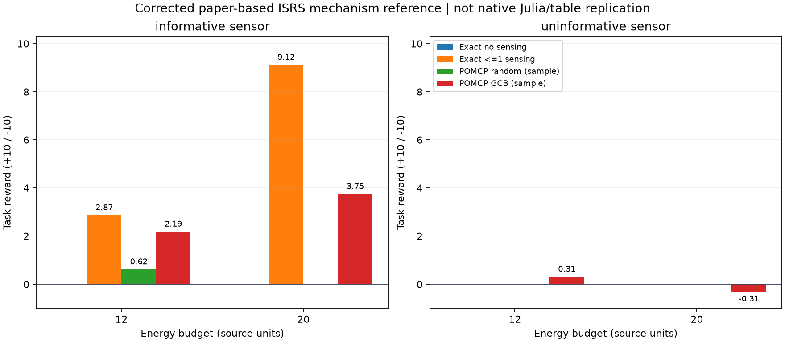

# AIPPMS 信息价值受控验证

2026年11月2日。本轮完成固定作者源码审计及修正后的小规模Python参考实现。**没有运行作者Julia环境，没有复现论文原表格，也不是灾后真实数据效果实验。**

## 为什么没有原样运行仓库

已固定[作者仓库](https://github.com/sisl/SBO_AIPPMS/tree/24db0a618a98f7c0c9bed470d25cc68fe6dc9b50)的提交`24db0a618a98f7c0c9bed470d25cc68fe6dc9b50`。本机没有Julia，仓库没有Project.toml/Manifest.toml，脚本还含作者本机绝对路径。未安装全局运行时或大量依赖。更关键的是，ISRS信念更新在接收观测后，似然判断使用隐藏的`env.location_states`，而传入观测仅出现在函数参数中。该版本不能原样作为信息公平基线；这是固定源码的静态审计结论，不据此判断论文发表结果。具体位置和修正见`upstream_source_audit.json`。

## 实际验证的机制

沿用源码默认5×5三岩石布局、近/远传感成本0.5/2及距离衰减公式，明确增加三个固定信标，并保留全部8种隐藏好坏配置。移动消耗1能源单位，传感只在信标进行，返回起点也消耗预算；预算12/20，20为主预算。首次好岩石+10，坏或已消耗岩石-10，遵循该版本源码，不是损伤像素召回或找到人员数。

公开状态仅含位置、预算、已消耗对象与观测后验；真实状态仅由环境执行器持有。贝叶斯更新使用实际收到的观测并按总概率归一化；规划模拟从当前信念抽取假想世界，再从该假想世界生成观测。

设置有信息传感器与已知正确率0.5的无信息传感器。无感知/最多一次感知采用精确有限预算动态规划，并穷举真实世界和全部观测分支核对期望值；最多一次感知并不是可重复感知策略的全局上界。POMCP参考采用每次100模拟、树深5、随机/GCB rollout；UCT尺度10、折扣1、允许回家提前结束、精确期望模式增益均为明确实现选择，不是作者库逐字移植，未根据结果调参。

## 结果

| 传感模型 | 预算 | 策略 | 精确期望或样本平均奖励 | 平均消耗能源 | 感知概率或平均调用 |
|---|---:|---|---:|---:|---:|
| informative | 12 | exact_no_sense | 0.0000 | 0.000 | 0.000 |
| informative | 12 | exact_one_sense | 2.8717 | 10.000 | 1.000 |
| informative | 12 | pomcp_random | 0.6250 | 2.656 | 0.531 |
| informative | 12 | pomcp_gcb | 2.1875 | 10.391 | 2.938 |
| informative | 20 | exact_no_sense | 0.0000 | 0.000 | 0.000 |
| informative | 20 | exact_one_sense | 9.1217 | 18.500 | 1.000 |
| informative | 20 | pomcp_random | 0.0000 | 0.141 | 0.062 |
| informative | 20 | pomcp_gcb | 3.7500 | 15.906 | 3.719 |
| uninformative | 12 | exact_no_sense | 0.0000 | 0.000 | 0.000 |
| uninformative | 12 | exact_one_sense | 0.0000 | 0.000 | 0.000 |
| uninformative | 12 | pomcp_random | 0.0000 | 2.578 | 0.656 |
| uninformative | 12 | pomcp_gcb | 0.3125 | 5.969 | 1.438 |
| uninformative | 20 | exact_no_sense | 0.0000 | 0.000 | 0.000 |
| uninformative | 20 | exact_one_sense | 0.0000 | 0.000 | 0.000 |
| uninformative | 20 | pomcp_random | 0.0000 | 0.062 | 0.031 |
| uninformative | 20 | pomcp_gcb | -0.3125 | 4.625 | 0.875 |

精确结果为全分支加权期望；POMCP是每条件8种世界×4种固定种子的32次运行，不能写成32个独立场景，也不能和精确分支数作样本量比较。有限模拟的POMCP可能低于受限精确参考，甚至对无信息观测付费，不据此修改搜索深度或择优报告。

## 对灾前灾后路线研究的意义

这个任务中，信标观测直接覆盖尚未访问的岩石，因此即使岩石相互独立，也能帮助后续选点。信息价值不要求任意相邻区域共享损伤状态。它与当前256像素局部缓存任务的关键差别是观测范围：当前任务只在已到达格获得当地预测，尚未建立对其他候选点的可靠信息通道。

本轮仅验证已知观测模型下的行动机制。下一步先核实灾害任务中的真实信息通道：同一次可用观测能否覆盖未访问候选点，或者在独立场景中是否存在可验证的语义关联。没有证据时不扩展同邻格传播；没有真实新视角时不把重复缓存当作复核。

双层地图继续保存结构先验与已付证据，但收益由观测与决策机制检验；模拟奖励不并入旧真实影像结果。无需GPU或新训练。

[固定协议](protocol.json) · [费用与重放核验](audit.json) · [源代码审计](upstream_source_audit.json) · [完整结果](summary.json)

来源：[AIPPMS论文](https://arxiv.org/abs/2003.09746)、[SBO-AIPPMS论文](https://arxiv.org/abs/2209.07660)。作者源码MIT许可见`UPSTREAM_LICENSE.txt`。

## 机制判断与接入边界

预算12/20下，最多一次感知的精确期望收益分别为2.8717/9.1217，不感知均为0；无信息传感器下，两者精确期望均为0。该对照验证的是已知远距观测模型中的信息价值，不是新方法的灾害任务增益。

主预算20下，有限计算POMCP-GCB的样本平均收益为3.75，低于最多一次感知的精确参考9.1217；POMCP可重复感知，所以这不是严格的策略集合上界比较，也没有测得实用的高效最优策略。无信息条件下GCB样本均值在预算12/20为+0.3125/-0.3125，不能当作观测收益；精确零收益结论不受这组有限样本波动影响。没有根据这些结果重选参数或种子。

另一个必须解决的任务差异：岩石模型通过到访获得任务奖励；建筑损伤巡查可能在拍摄判读时已经完成任务。因此后续不能原样复制“观察一次，再到目标位置领奖”的结构，须先确定真实观察范围、可判读程度及任务完成条件。

对应双层地图，先验层可保存任务结构与初始概率，证据层保存已付观测及来源；二者融合后的信念交给规划器。双层组织本身仍未被证明带来收益。
