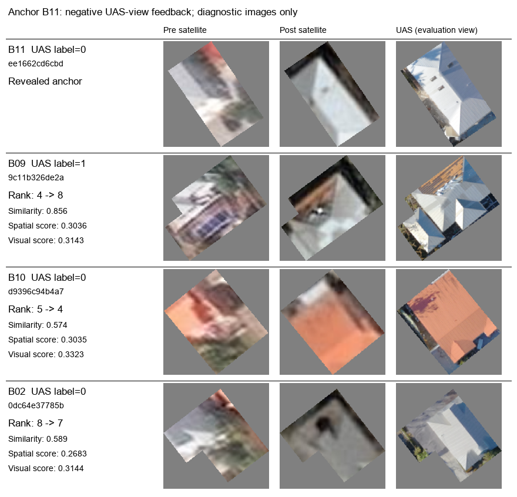
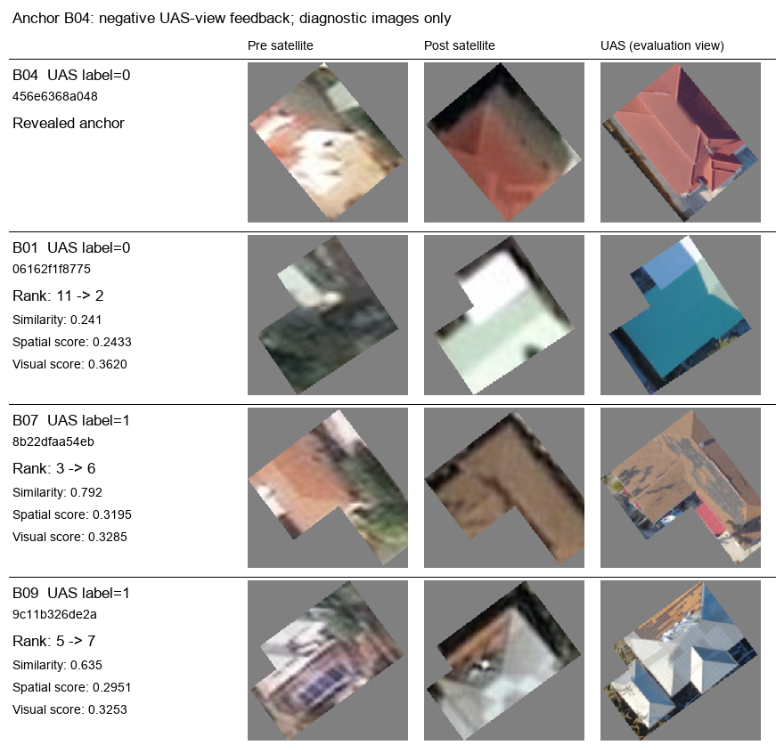

# 哪栋建筑让视觉门控输给空间更新？

2026-11-03。对已有固定结果的逐样本错误审查；没有新模型调用、没有更改预测或阈值。此前只做了输入切片检查，本轮首次将排序变化与具体建筑对应。

**主要净损失来自B09（ID `9c11b326de2a4e4aa731385dc2fb3baf`）。** AP从0.459772降至0.435941，差−0.023832；按正例在AP公式中的贡献分解，B09为−0.020602，约占净差的86.4%。B03为−0.006944，B07为+0.003715，三者之和复原总差。不是所有锚点均变差：4次改善、5次下降、3次持平。

## 具体退位

|阴性锚点|受影响目标|空间排名→视觉排名|要看什么|
|---|---|---|---|
|B11|B09（UAS视角minor）|4→8|与浅色屋面锚点相似度0.856，仍保留较强阴性修正|
|B12|B09（UAS视角minor）|2→4|B11等无损目标被更大幅度保护并超过B09|
|B04|B07（UAS视角minor）|3→6|红／褐色外观较相似，相似度0.792|
|B04|B01（UAS视角no damage）|11→2|相似度仅0.241，阴性修正被大幅削弱，是本例挤占排序的主要无损目标|

B07在B04案例退位，但其跨所有锚点的AP贡献略升，不能把它说成整体净损失来源。B09才是主要净损失目标。

## 分数上升，排名为什么下降

B11作为阴性锚点时，B09的分数**从0.3036升到0.3143**；B10（无损）则从0.3035升到0.3323，超过了B09。B08、B12、B02也超过B09，故4→8。

当前更新式是 `p_visual(i)=p0(i)+w_space(A,i)*similarity(A,i)*residual(A)`。阴性锚点的residual为负，乘小于1的相似度会减弱扣分。因此，视觉门控并没有直接降低这些目标相对空间组的分数；它对某些无损目标“少扣了更多”，使其插队。

反事实核对：12个案例中，视觉组有4次AP改善，说明不是添加视觉特征必然有害；具体问题在于这版相似度能否支持正确的负反馈迁移。

## 对照切片

以下目标UAS图仅供结果审查，原预测过程没有读入目标UAS图。

B11与B09的灾后卫星切片都含较多浅色屋面。B09的UAS图可见局部褐色屋面／裸露样区域，B11以连续浅色屋面为主；损伤标签沿用作者UAS视角记录，不由这次看图重新标注。作为无损对照的B10屋面偏橙色，与B11的低阶外观距离更大，却因此得到更强保护。

在标准化特征距离中，B11—B09的平方距离23.111里，灾后颜色直方图及均值／标准差贡献22.546，灾前灾后差分统计仅0.565。这解释了该核主要按外观相似迁移，而没有编码“相同误判原因”。这不是对真实冲突原因的因果判定。

B04较完整的红色屋面与B07褐色、纹理变化明显的屋面仍有较高低阶相似度。B01卫星切片偏浅绿／白，与B04不同，阴性修正因此从较强变为较弱，排名11→2。

## 对下一步的直接启发

当前视觉组**已经使用逐栋掩膜切片，而不是整图特征；也已包含6维灾前灾后差分均值／标准差**。更有意义的下一项是固定空间核、p0和反馈，分别比较“去掉视觉门控”“只用变化统计”“冻结语义变化表征”等表征消融，而不是再把已有简单差分加一次。

先把这作为开发诊断，随后用其他区域留出验证；不在B09上追阈值。路线A和B仍是候选，没有因这次审查自动变成已成立方法。模型提取的遮挡／材质可作特征候选；配准偏移需要对应图像或几何证据，不能要求单张图直接判定跨源配准是否正确。未付费NOAA证据也不能作为免费的初始分歧输入。

细节：[全部132条排名变化](target_rank_changes.csv)、[逐锚点AP](per_anchor.json)、[正例贡献分解](summary.json)、[特征距离组成](feature_distance_components.json)。这些是对旧结果的解释，不是新的确认性收益。
