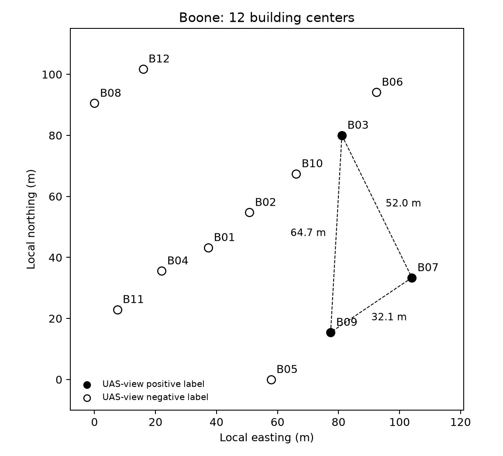

# Boone两步反馈检验：固定Pearson候选

2026-11-03。按用户指定的`Anchor→Step1→Step2`执行。12个起点、两种选点准则、四种更新方式，共96条两步序列。无新感知模型推理、训练、API费用或GPU租赁。

## 阳性建筑的空间关系

沿用原UTM建筑多边形顶点中心计算直线距离；这是近似档案几何，不是经测绘认证的实际航线。

|建筑对|距离|
|---|---:|
|B03—B07|52.01m|
|B03—B09|64.69m|
|B07—B09|32.11m|

12栋中心范围约104.1×101.8m，全部66个建筑对的中位距离60.53m。B07与B09较近，B03在北侧，没有三栋紧邻成团。B03最近的B06、B10分别18.05m、19.59m，均为UAS视角阴性。



## 冻结的两步合同

- 每个起点A0的UAS作者视角标签作为共同已知历史；不把A0算作新检出或新核查。每种方法新访问两栋，禁止重访和收益重复计数。来源标签为档案反馈，不称共同现场真值。
- 起步用同一冻结p0，先利用A0反馈更新一次，选A1；移动到A1后才读取A1标签，再更新剩余10栋，选A2；到A2后才读取其标签计分。
- 第二次残差为`label(A1) - score_before_observing(A1)`，当前分数已包含A0反馈。保留A0形成的状态，不重放A0标签，不重新从p0叠加两次初始残差。
- Pearson特征核全程冻结，空间尺度50m、增益0.5；不更换核宽，不改表征。更新只写未访问候选分数，观测保存在独立历史。
- 幅度匹配控制在**自己的状态、自己的已访问集合、自己的新反馈**上计算假想Pearson更新的幅度，再解标量空间增益匹配该幅度。它不读取另一策略才访问的标签。两条路径分叉后不要求使用非法的共同未来反馈。
- 主选点规则固定为`score / distance(current,target)`；纯分数规则作诊断，所有同分按建筑ID排序。
- 固定的是两次新观察，不是统一航程／电量预算。报告A0→A1→A2移动距离，并另外报告返回A0的闭合距离；不编造飞行速度、观察时长或现场通行限制。
- 用户初筛线：Pearson对幅度匹配控制累计净增>1次，且没有更低命中的起点案例。任一失败则停止Boone视觉核搜索。该门槛在看本次结果前写入运行代码，属于已查看区域的开发检验，不是独立验证。

## 主结果：分数／距离选点

下表为12起点合计，24次新观察；观察次数和命中均是重叠案例累计，不是24个独立对象。

|更新方式|第一步命中|第二步命中|两步命中|两段移动总距离|含返程总距离|
|---|---:|---:|---:|---:|---:|
|Pearson反馈|5|3|8|626.94m|1198.87m|
|幅度匹配空间控制|4|1|5|622.81m|1145.48m|
|原空间反馈0.5|4|2|6|655.99m|1236.36m|
|不更新|4|1|5|619.05m|1143.61m|

**Pearson对幅度控制净增3次，3胜9平0负，达到用户两步初筛线。** 相对原空间反馈净增2次，2胜10平0负。Pearson比幅度控制两段移动增加4.12m（约0.66%），含返程增加53.39m（约4.66%）；三次胜场均用了更长航程。因此通过的是“两次访问下的初筛”，尚不是相同电量／航程预算的收益证明。

|起点|Pearson路径|幅度控制路径|Pearson命中|控制命中|两段距离差m|含返程差m|
|---|---|---|---:|---:|---:|---:|
|B01|B01→B04→B11|B01→B02→B10|0|0|-1.19|-2.67|
|B02|B02→B10→B03|B02→B01→B04|1|0|+4.65|+9.56|
|B03|B03→B10→B02|B03→B06→B10|0|0|-16.04|+3.85|
|B04|B04→B01→B02|B04→B01→B02|0|0|+0.00|+0.00|
|B05|B05→B09→B07|B05→B09→B07|2|2|+0.00|+0.00|
|B06|B06→B03→B10|B06→B03→B10|1|1|+0.00|+0.00|
|B07|B07→B09→B05|B07→B09→B05|1|1|+0.00|+0.00|
|B08|B08→B12→B03|B08→B12→B01|1|0|+6.39|+27.93|
|B09|B09→B07→B10|B09→B05→B01|1|0|+10.31|+14.73|
|B10|B10→B03→B06|B10→B03→B06|1|1|+0.00|+0.00|
|B11|B11→B04→B01|B11→B04→B01|0|0|+0.00|+0.00|
|B12|B12→B08→B01|B12→B08→B01|0|0|+0.00|+0.00|

三个净胜起点：B02经B10转B03；B08经B12转B03；B09经B07转B10。前两例额外命中B03，后一例额外命中B07；并未获得“先到B03后再连续找到其他阳性”的接力。把B03命中从评价中去掉（不改变实际轨迹），Pearson仍有4次、控制3次，净差只剩1，说明优势仍有明显单点依赖。

## B03的阳性反馈到底发生了什么

在主规则下，第一步访问B03的起点只有B06和B10。两种方法的后续分别都是：

- B06→B03（阳性）→B10（阴性）。
- B10→B03（阳性）→B06（阴性）。

纯空间0.5也得到相同后续目标。B03的正反馈没有把B07或B09推到下一步第一名。

另做只读诊断：在每条已发生轨迹的同一位置，忽略A1反馈、仅用A0之后的旧分数再选A2。主规则下Pearson和控制各有1/12例改变第二目标，均为B08起点：Pearson从B02改为B03（阳性），控制从B02改为B01（阴性）。这例实际体现第二次反馈带来的决策差异；其余11例有数值更新，但第二目标未改变。该诊断没有额外揭示未访问标签来选点。

## 纯分数选点诊断

|更新方式|第一步命中|第二步命中|两步命中|两段移动总距离|含返程总距离|
|---|---:|---:|---:|---:|---:|
|Pearson反馈|9|0|9|1360.43m|2155.97m|
|幅度匹配空间控制|1|1|2|1963.85m|2804.51m|
|原空间反馈|1|1|2|1940.09m|2781.73m|
|不更新|1|10|11|1132.37m|1898.40m|

Pearson对幅度控制7胜5平0负，但**不更新反而11次、高于Pearson9次且距离更短**。因此不能只汇报9对2来主张在线反馈普遍胜出。Pearson在7次第一步到B03后，第二步都没有命中；它的纯分数头部优势没有形成第二步阳性接力。

## 裁决与下一步

按用户指定的两步命中初筛保留Pearson候选，不继续在Boone修改视觉特征、核宽或增益。下一项固定方法与选点规则，加入同航程且含返程的预算、距离优先／充分求解静态／不更新强对照，并按既定区域顺序检验外部场景；保留既有单通道或覆盖不足排除，不挑替代区域追分。当前阶段可称“单区域两步初筛通过”，不可称跨区域泛化、独立统计显著性、现场损伤捕获或无人机闭环验证。

## 复现与核验

```bash
work/disaster_search/.venv_inference/bin/python \
  work/disaster_route/run_boone_two_step.py \
  --output output/disaster_route_boone_two_step_v1
work/disaster_search/.venv_inference/bin/python \
  work/disaster_route/audit_boone_two_step.py \
  --output output/disaster_route_boone_two_step_v1
work/disaster_search/.venv_inference/bin/python \
  work/disaster_route/plot_boone_two_step_geometry.py \
  --output output/disaster_route_boone_two_step_v1
```

运行器要求新目录。见[汇总表](summary.csv)、[逐案例完整历史与分数](episodes.json)、[配对结果](paired_results.json)、[几何与全部距离](geometry.json)、[第二次反馈诊断](second_feedback_diagnostic.json)、[执行合同](execution_recipe.json)、[独立重放核验](audit.json)、[可编辑SVG位置图](building_map.svg)。NOAA来源的事后命中作为单独敏感性诊断保留于汇总，不参与策略输入。

17项Boone测试通过；独立重算96条路径、192次更新与选点、288次实际来源标签读取，399个历史封存文件哈希不变。首轮更新的528个目标分数与此前冻结单锚点实验一致。
