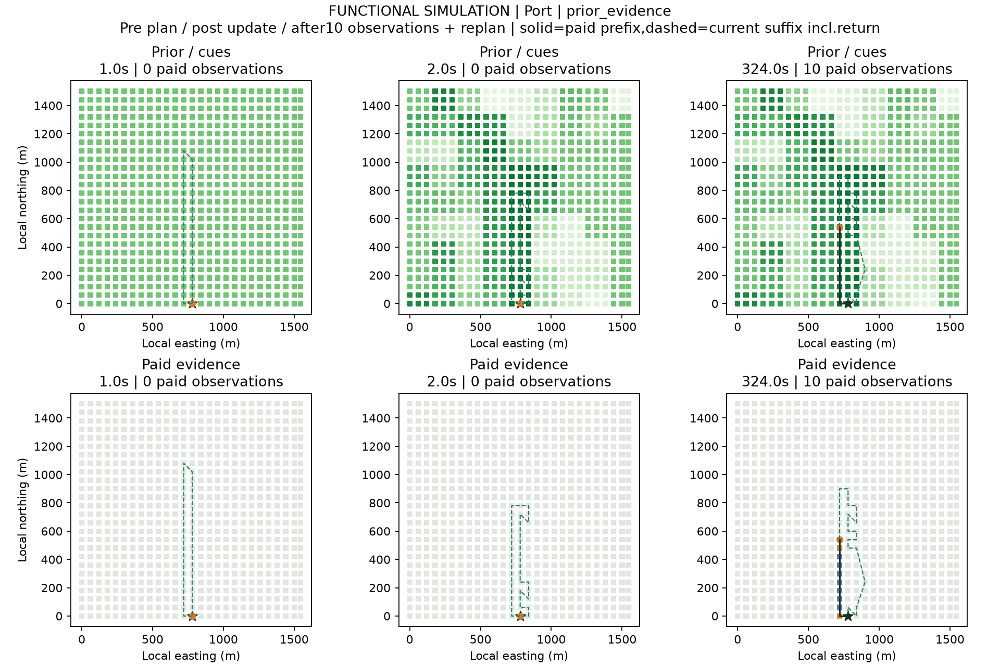
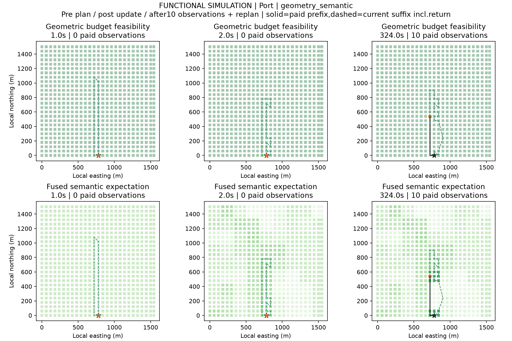
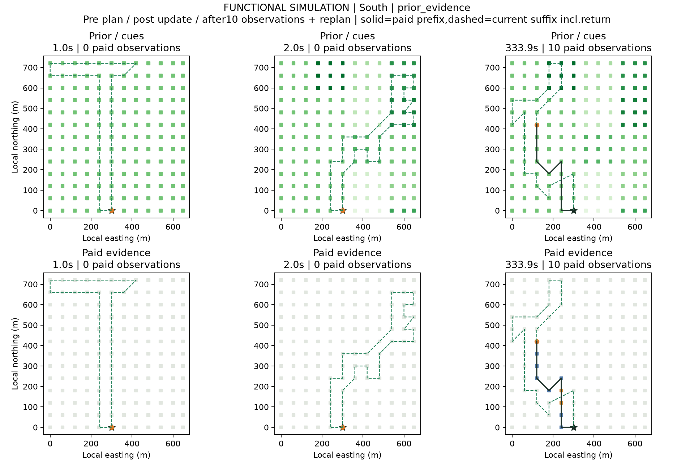
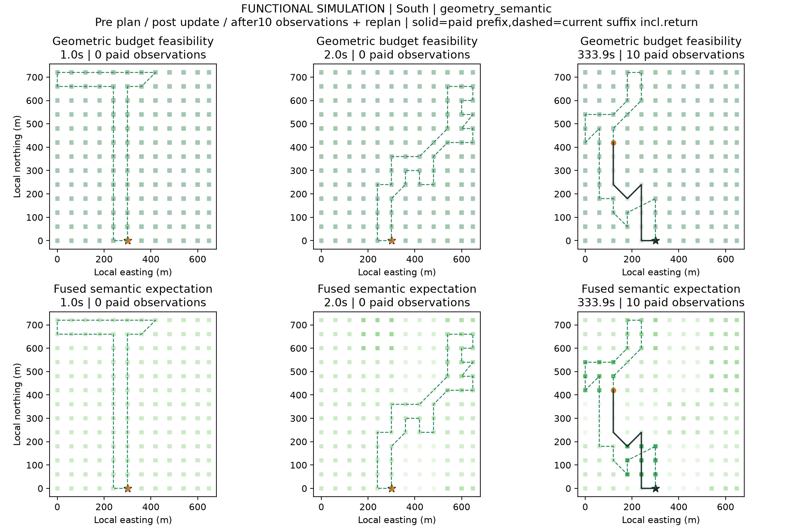

# 灾前灾后Agent搜查：两种双层地图原型

2026-11-02。[打开可切换回放](demo.html)。无需服务端或网络，直接用浏览器打开本目录的demo.html。

已经接通同一Agent的灾前规划、接收灾后线索、执行付费观察、更新地图、每5次重规划和返程。界面可选两区、三种路线策略、两种地图组织，并逐步回放或跳转灾前、灾后、第10次观察和最终返程。点击格子查看当时可用线索、后验和观测状态。

| 方案 | 第一层 | 第二层 | 决策输入 |
|---|---|---|---|
| 1 | 搜索先验/线索 | 沿途付费观测证据 | 两层融合信念＋共享几何与预算 |
| 2 | 平面几何代价/预算可行性 | 保留同一先验与证据的语义搜索状态 | 相同融合信念＋相同几何与预算 |

两种组织保留完全相同的信息，由同一求解器产生逐动作相同的路线。这是接口公平性与功能一致性验证，**不是两种新算法的效果比较，也不说明双层地图已提高搜查收益**。两种组织可以在以后组合使用：第一种管理搜索记忆，第二种向路线规划提供代价与语义接口。

## 已实际完成

使用V4已经用过的两区第一个种子2026110200、先验正确、中等模拟误差、1200秒案例。每区三种策略各执行两种地图模式，共12条闭合路线；没有按发现结果换例。三种策略为保持灾前路线、灾后修订一次后固定、沿途每5次观察重规划。

67项测试通过，其中新增14项。全部12条路线、两模式的6组逐动作一致性、12个第10次观察后的状态恢复与继续执行均已核验。证据只在移动和20秒观察完成后写入；未知格保持未知，阳性不升级成独立真值，阴性不等于排除目标。原始先验在沿途观察时不被覆盖，后验由当前先验和付费证据重新构造。

所有策略支付1秒灾前规划；灾后静态和在线策略再支付1秒灾后修订。后续调用也逐次收费，全部包含在同一1200秒预算中，返程另按实际距离计费。因此这批功能案例的准备费约定与V4不同，不能混合绝对分数排名。以下只报告几何和费用，不用两例正确发现量宣称方法优劣。

| 区域 | 策略 | 观察格 | 付费规划次数 | 往返米 | 总秒 |
|---|---|---:|---:|---:|---:|
| 口岸 | pre_static | 37 | 1 | 2245 | 1190.0 |
| 口岸 | post_static | 36 | 2 | 2210 | 1163.9 |
| 口岸 | online_5 | 34 | 8 | 2479 | 1183.8 |
| 南侧建筑区 | pre_static | 37 | 1 | 2245 | 1190.0 |
| 南侧建筑区 | post_static | 37 | 2 | 2276 | 1197.2 |
| 南侧建筑区 | online_5 | 34 | 8 | 2503 | 1188.7 |

## 两层地图与路线阶段

四张图分别展示两区的两种组织，列为灾前计划、灾后修订、第10次观察后重规划；两行是各自两层。黑色实线为已经支付的路径，绿色虚线为当前余下路线及返程。地图不画未来观测或模拟目标真值位置。

## 输入边界与下一项

PS几何、已有前后影像和变化分数来自既有缓存。灾前仍使用均匀占位先验，尚未完成真实建筑/人口暴露图；灾后热点先验由变化排名人为构造，不是已校准灾损概率。观测及目标沿用模拟世界，固定误差率0.8/0.1为已知模拟假设，未调用新识别器。

方案2目前是直线移动代价和预算可行性，真实道路通行、地形障碍、禁飞及飞行动力学没有接入；缺失值保留null。界面不把预算可行性写成已验证通行或飞行安全。实际无人机、VLM或LLM工具调度尚未接通，当前Agent为可恢复的确定性闭环控制原型。

这一步建立状态表示、付费更新和可解释回放。下一步优先补有来源的灾前结构信息与几何通行约束，在同样信息和求解器下再冻结效果实验；单层充分统计量基线不能通过故意丢失信息被削弱。已有基线、负例和感知汇报保持。

## 回放与复验说明

浏览器文件包含完整已执行轨迹，时间轴只渲染所选时刻的前缀；它是离线记录，不作为在线Agent的受限观测接口。在线控制器自身只在付费step后取得信号，浏览器数据不含未执行格的环境观测数组或模拟真值位置。

初次快照审计将内存中的误差率元组与JSON保存的数组直接比较，出现类型差异；规范化后12条恢复结果的JSON值完全一致。补充审计器`audit_dual_map_demo_resumed.py`保留原审计逻辑，只规范化该元数据字段，原冻结源码和路线数据未改。浏览器检查另修复了切换区域/策略后的格子说明残留；修订记录为`viewer_amendment_01.json`，同样不改变Agent行为。可复验源码均在`source_snapshots/`中。
