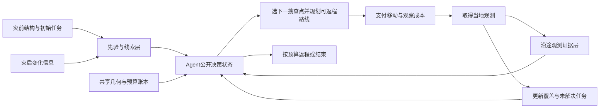

# 面向灾前灾后搜查的双层地图与Agent路线规划

2026-11-02最新方向诊断：[同预算提升空间](../disaster_route_headroom_v1/README.md)完成324条精确/事后理想路线核验，99项路线测试通过。主预算尼泊尔原静态/同线索精确/检出Oracle为32.11%/32.17%/40.91%；海啸仍0；龙卷风仅3参考阳性，不凭其理想差距挑事件。表明当前线索和可利用信息需要先检验，补地理字段或只换求解器不足以支持在线收益。下一步优先成熟AIPPMS受控参考与观测价值检验，双层地图保留状态接口；真实地理/配准/平台验证后置，旧传播规则不调参恢复。无新增推理、训练或GPU。

2026-11-02后续结构接入：[新试验](../disaster_route_structure_pilot_v1/README.md)已把原灾前建筑XY/WGS84轮廓接入先验、付费证据与预算路线。四个固定开发身份中三个可用、一个保留几何拒绝；54条路线、90项测试通过。传播只沿同一建筑UID，覆盖保底作为固定候选；9组配对中保底没有新增动作变化，未证明算法收益。坐标仍为内部一致性重建，非独立地理或真实执行验证；下一步先解决地理/配准/平台约束。

2026-11-02，依据用户最新方向提醒建立。本文件调整后续研究范围，不改变已经冻结的V1—V4结果。

**研究主体：Agent利用灾前结构信息、灾后变化和沿途观测，在移动、观察、规划、返程共享预算内选择搜查目标并更新路线。双层地图是该闭环的状态表示与决策接口。**

“误差率估错”降为后续稳健性检验，不再排在双层地图与完整搜查闭环之前。已停止的一标准差触发器不恢复。识别精度检查保留为汇报支线。

## 双层地图的工作定义

用户已选择“搜索先验/线索＋沿途观测证据”，随后明确“1、2都想试”。因此当前同时实现两种组织：方案1为先验/线索＋沿途证据，方案2为几何代价＋目标语义。方案2的语义状态保留相同先验、证据和融合信念；真实通行状态仍未知。

已完成[两种方案的可切换功能回放](../disaster_route_dual_map_demo_v1/demo.html)，功能核验见[原型报告](../disaster_route_dual_map_demo_v1/README.md)。以下架构表主要解释方案1，方案2将共享几何独立作为一层，并将先验、证据和融合状态组织到语义层。

| 组成 | 记录什么 | 灾前、灾后怎样变化 | 对路线的作用 |
|---|---|---|---|
| 第一层：搜索先验/线索地图 | 灾前建筑与道路等已取得的结构信息、初始搜查优先级；灾后变化、未知区域及来源可靠性 | 灾前初始化；灾后加入变化线索，同时保留灾前底图和时间来源 | 形成初始巡查路线与待查区域候选 |
| 第二层：在线观测证据地图 | 已支付观察的覆盖范围、阳性/阴性信号、采集时间、来源、质量与复核状态 | 初始未观测；Agent到达并付费观察后写入，随行动积累 | 更新目标信念、识别尚未查清区域，支持后续选点与重规划 |
| 共享几何与执行账本 | 同一坐标系、区域边界、可用的距离/通行信息、当前位置、剩余预算与返程代价 | 只按有来源的输入更新；未知障碍或道路状态保留未知 | 检查移动与返程是否可行，计算实际行动成本 |

灾前/灾后是时间阶段；双层地图是功能划分。两者不是一一对应关系：先验层会在灾后更新，证据层也会在灾后搜查过程中持续变化。

目前PS数据可以提供几何和变化线索。真实建筑暴露、道路可达性、灾损目标和安全飞行条件须按实际可用输入分别记录；没有输入的字段不能假装已提取完成。既有变化分数不是已经校准的受灾概率。

已有文献[AeroBelief，Sec. III-D](https://arxiv.org/html/2609.08164v1)区分情境线索与合格目标证据。本项目拟借鉴分层记忆的思路，具体面向灾前灾后累计搜查和带返程预算的路线任务。当前没有复现其VLM、证据门控或导航系统，也没有证明灾害任务上的新颖性。

## Agent必须完成的闭环

Agent状态至少包含当前位置、剩余预算、两层地图、观察覆盖、未完成任务和当前剩余路线。动作包括移动、观察、更新地图、必要时重规划以及返程。初版可沿用固定感知器和确定性规划工具；是否引入LLM，取决于是否需要任务解释、语义信息接入或工具选择，不以调用大模型本身替代路线决策。

灾前阶段形成巡查模板或初始候选路线；灾后阶段结合已获得信息修订；执行阶段只使用已经获得的观测继续更新。任务继续保持同预算覆盖、目标首次到达/发现、总距离、总耗时和规划调用的完整评价。

证据层必须区分“观测阳性”和“目标已确认”。模拟阳性和固定识别器输出都不能自动改写成独立人工真值；一次阴性也不等于该区域已彻底排除。重复观察如果后续开放，必须重新计费，并区分新增覆盖与复核收益。

## 现有进度与缺口

| 模块 | 已有基础 | 尚需完成 |
|---|---|---|
| 灾前/灾后输入 | 两个PS区域的几何、前后影像变化线索 | 真正灾前暴露结构的接入，以及输入来源和时相的统一记录 |
| 先验与证据 | 后验数组、已付观测历史、覆盖记录 | 两层明确的字段、更新规则、来源追溯和地图输出接口 |
| 路线闭环 | 连续移动、观察、规划与返程计费；静态和在线策略 | 让选点、规划和执行明确读写两层地图，并展示地图更新导致的路线变化 |
| 执行状态 | 可序列化状态、恢复和同状态分叉 | 将双层地图状态纳入快照；验证恢复不丢失或重复累计证据 |
| 实验评价 | V1—V4可核验的基线及负例 | 双层表示下的信息公平对照、阶段地图及完整路线案例 |
| 真实有效性 | PS真实几何与变化代理 | 独立目标参考和真实移动约束；当前模拟发现量不替代这些验证 |

既有热点先验、Bayes后验和观测日志提供实现基础，但不能仅凭已有两个数组就宣布双层地图系统已经完成。

## 已完成的首个功能里程碑

下列基础接口及可视化已在原型中接通，尚未建立新的效果收益：

1. 固定两层地图的数据字段、共同坐标及来源类型；直接复用现有PS网格和观测记录，不生成伪造真实标签。
2. 将灾前初始化、灾后更新和沿途付费观察写入统一Agent状态，保留两层各自内容和融合后的规划输入。
3. 在同一案例中输出灾前路线、灾后初始路线、执行中的地图与路线变化，以及含返程的最终路径。视觉上能同时查看两层，而不仅是一条最终折线。
4. 在表示与成本核验通过后，再冻结效果实验。保留灾前静态、灾后静态、每次在线和每5次在线基线，统一信息可用时刻、观察费用、求解器及预算。

如果单层Bayes后验是充分统计量，显式双层表示可能与其产生相同动作。双层接口的可解释性和记忆能力可以先验证；不能通过故意丢弃单层基线已有信息来证明算法更好。删除灾后信息或在线反馈的消融衡量的是信息来源贡献，须与地图表示自身的贡献分开解释。

误差率失配、地图更新延迟和先验错误保留为后续压力测试。GPU或新识别训练不是当前功能里程碑的前置条件。

## 原结果保留

- [V1：路线闭环](../disaster_route_loop_v1/README.md)
- [V2：求解器与停止规则](../disaster_route_factor_v2/README.md)
- [V3：快照分叉](../disaster_route_snapshot_v3/README.md)
- [V4：付费触发与负结果](../disaster_route_trigger_v4/结果复盘与下一步.md)
- [感知阶段汇报](../感知检查_阶段汇报_20261028/)

历史文件中的“下一步”保留为当时安排。用户最新提醒后的当前工作顺序以本文件与`decision.json`为准。本范围说明最初没有运行新实验；后续已完成两种组织的12条功能路线及状态核验，见原型目录完成收据。这不等于独立灾害效果实验。
