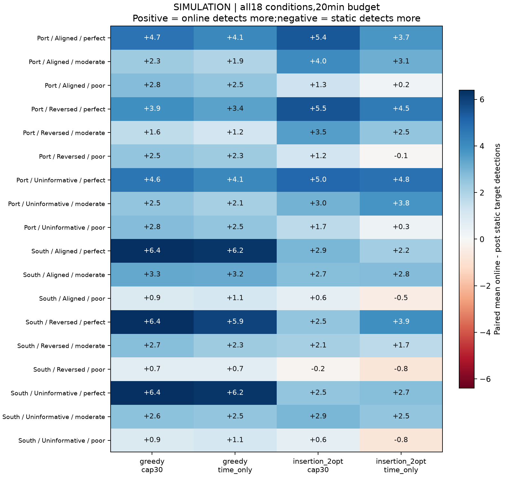
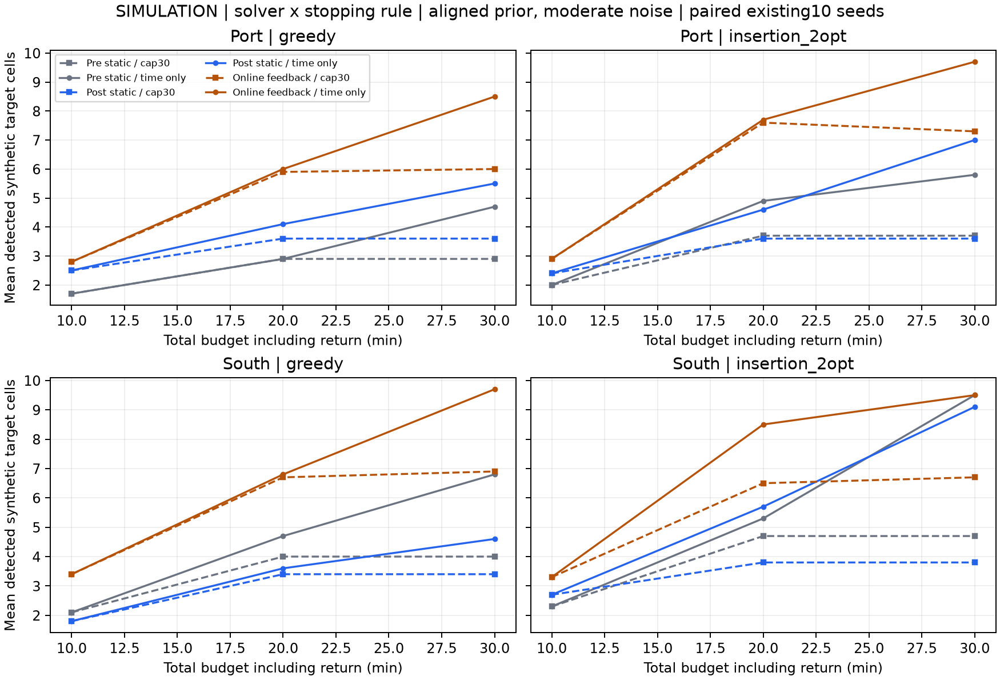
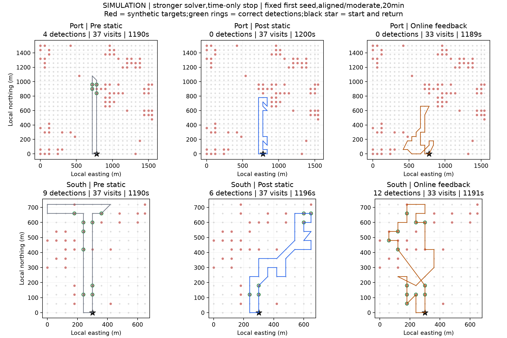

# 强化路线对照与观察上限实验

2026-11-02。检验在线反馈收益能否经受更强静态路线对照，并把求解器质量与30次观察上限分开。沿用上一轮全部60个合成目标场、观测随机数、两个PS几何区域与预算；本轮为事后开发敏感性分析。

## 本轮判断

在线收益在强化对照后仍有保留，但存在明确的误差边界。20分钟主预算、强化求解器、仅按时间停止时，理想和中等误差的12个条件全部为在线平均发现更多；较差误差的6个条件为2正、4负。对“重算但不更新”对照也有3个负条件，均在南侧较差误差下。这不能支持在线始终优于静态，也没有否定所有观测质量下的反馈收益。

同为先验正确、中等误差、20分钟、强化求解器、仅时间停止，口岸灾前/灾后静态/在线的平均正确发现为4.9/4.6/7.7格，南侧为5.3/5.7/8.5格。两区中等误差的收益仍在；不能将上一轮全部收益归因为弱静态对照。

较差误差下的全部4个负条件如下，不按负例改变主预算或删选场景：

| 区域 | 先验条件 | 灾后静态平均发现 | 在线平均发现 | 在线减静态 |
|---|---|---:|---:|---:|
| 南侧建筑区 | 正确 | 5.1 | 4.6 | -0.5 |
| 南侧建筑区 | 无信息 | 4.6 | 3.8 | -0.8 |
| 南侧建筑区 | 反向 | 3.6 | 2.8 | -0.8 |
| 口岸 | 反向 | 0.9 | 0.8 | -0.1 |

南侧先验正确、较差误差时，在线平均观察32.5格、往返2535米，灾后静态37格、2276米；更多移动与更少观察同时出现，值得进一步拆解改路成本。不过，在线的首次正确发现受限时间约383秒、静态428秒，无发现率10%与20%。发现总量和早发现存在权衡，不能据此断言较差观测时一律不应改路。这里误差率仍为已知的.6灵敏度/.25误报率，尚未测试未知或错设误差率。

观察次数上限确实遮蔽了预算收益。南侧先验正确、中等误差、30分钟、强化求解器下，灾后静态由cap30的3.8格升至仅时间停止的9.1格，在线由6.7升至9.5格；两者差值由2.9格缩至0.4格。30分钟预算下取消上限后，静态约56次、在线47.7次观察，较原上限多出的观察有实际发现贡献。

下一阶段值得检验的是“低可靠反馈下是否应保留原路线、何时修改剩余路线”。先以强化求解器与仅时间停止为共同对照，比较始终重规划、预先固定周期、基于完整剩余预算的预计收益触发；普通周期规则已足够时不增加复杂门控。所有18个条件均保留，不能只围绕4个负条件调阈值；新机制先在明确开发部分确定，再用前瞻固定的新合成实例检查，复用结果不作为独立确认。移动与返程按实际路径计费，不再重复添加一笔同义转场惩罚。真实误差率未知时的稳健性与实际飞行约束仍是后续独立问题。

## 二乘二对照

求解器为原贪心与“闭合路线插入加2-opt”两档，停止规则为最多30格与仅按时间停止两档。每档仍比较灾前均匀静态、灾后线索静态、反馈在线与重算但不更新四策略。共8,640条路线，其中原贪心加30格的2,160条逐动作与旧结果精确复现，计算耗时除外。

强化求解器同时保留原贪心节点集合与从空路线插入的候选；按每次插入对完整往返路线增加的时间报价，最多8次2-opt改进后补插，再选择公开先验期望奖励更高的路线。该性质只保证规划时使用的先验奖励不下降，不保证真实目标发现更多。所有方法仍是启发式，不宣称全局最优。

每次规划仍扣除假设的1秒，移动5m/s、每格观察20秒、预留返程。相同公开状态的规划采用共同LRU缓存，缓存键无目标或未来观测；命中也照扣仿真规划成本。实际CPU工作另记，强化求解器计算更多，本轮不宣称同计算量或部署提速。

## 主预算结果

下表是20分钟下18个区域/先验/误差条件的在线减灾后静态平均发现数方向，所有条件保留。

| 求解器 | 停止规则 | 正向条件 | 相同条件 | 负向条件 |
|---|---|---:|---:|---:|
| greedy | cap30 | 18 | 0 | 0 |
| greedy | time_only | 18 | 0 | 0 |
| insertion_2opt | cap30 | 17 | 0 | 1 |
| insertion_2opt | time_only | 14 | 0 | 4 |

上图各格由同一世界内配对差值先在10个种子上平均。不同噪声与先验模式共享部分随机流，18个条件不是18次独立灾害复验；不把方向计数作为显著性检验。`paired_comparisons.json` 同时保留对灾前静态与无更新对照的全部648份配对结果，`solver_effects.json` 保留各策略换求解器后的432份变化。

## 距离时间与首次到达

以下为先验正确、中等误差、20分钟、10种子的均值。首次到达和首次正确发现的原始失败值为null；表中失败填预算作为受限时间指标，并另报无发现率。覆盖与发现均是合成目标格，不是逐栋灾损或实际搜救人数。其余条件见全部条件汇总。

| 区域 | 求解器 | 停止 | 路线 | 正确发现 | 到达目标 | 观察格 | 首次到达或预算秒 | 首次发现或预算秒 | 无发现率 | 往返米 | 总秒 |
|---|---|---|---|---:|---:|---:|---:|---:|---:|---:|---:|
| 南侧建筑区 | greedy | cap30 | online | 6.7 | 9.3 | 29.5 | 204 | 253 | 10% | 2810 | 1182 |
| 南侧建筑区 | greedy | cap30 | post_static | 3.4 | 4.3 | 30.0 | 330 | 356 | 20% | 2128 | 1027 |
| 南侧建筑区 | greedy | cap30 | pre_static | 4.0 | 5.4 | 30.0 | 145 | 239 | 0% | 2331 | 1067 |
| 南侧建筑区 | greedy | time_only | online | 6.8 | 9.4 | 29.9 | 204 | 253 | 10% | 2817 | 1191 |
| 南侧建筑区 | greedy | time_only | post_static | 3.6 | 4.6 | 35.0 | 330 | 356 | 20% | 2409 | 1183 |
| 南侧建筑区 | greedy | time_only | pre_static | 4.7 | 6.3 | 35.0 | 145 | 239 | 0% | 2464 | 1194 |
| 南侧建筑区 | insertion_2opt | cap30 | online | 6.5 | 9.5 | 29.7 | 160 | 191 | 0% | 2829 | 1189 |
| 南侧建筑区 | insertion_2opt | cap30 | post_static | 3.8 | 4.8 | 30.0 | 289 | 358 | 20% | 1940 | 989 |
| 南侧建筑区 | insertion_2opt | cap30 | pre_static | 4.7 | 6.3 | 30.0 | 122 | 177 | 0% | 1800 | 961 |
| 南侧建筑区 | insertion_2opt | time_only | online | 8.5 | 10.6 | 32.3 | 100 | 166 | 0% | 2570 | 1192 |
| 南侧建筑区 | insertion_2opt | time_only | post_static | 5.7 | 7.0 | 37.0 | 289 | 379 | 20% | 2276 | 1196 |
| 南侧建筑区 | insertion_2opt | time_only | pre_static | 5.3 | 6.9 | 37.0 | 122 | 177 | 0% | 2245 | 1190 |
| 口岸 | greedy | cap30 | online | 5.9 | 7.2 | 28.3 | 457 | 471 | 30% | 2912 | 1177 |
| 口岸 | greedy | cap30 | post_static | 3.6 | 4.6 | 30.0 | 476 | 498 | 20% | 2582 | 1117 |
| 口岸 | greedy | cap30 | pre_static | 2.9 | 4.0 | 28.0 | 265 | 324 | 10% | 3125 | 1186 |
| 口岸 | greedy | time_only | online | 6.0 | 7.3 | 28.8 | 457 | 471 | 30% | 2935 | 1192 |
| 口岸 | greedy | time_only | post_static | 4.1 | 5.2 | 33.0 | 476 | 498 | 20% | 2640 | 1189 |
| 口岸 | greedy | time_only | pre_static | 2.9 | 4.0 | 28.0 | 265 | 324 | 10% | 3125 | 1186 |
| 口岸 | insertion_2opt | cap30 | online | 7.6 | 9.3 | 29.7 | 201 | 225 | 0% | 2724 | 1169 |
| 口岸 | insertion_2opt | cap30 | post_static | 3.6 | 4.5 | 30.0 | 372 | 408 | 20% | 1850 | 971 |
| 口岸 | insertion_2opt | cap30 | pre_static | 3.7 | 4.7 | 30.0 | 317 | 345 | 10% | 1800 | 961 |
| 口岸 | insertion_2opt | time_only | online | 7.7 | 9.8 | 32.6 | 270 | 291 | 10% | 2527 | 1190 |
| 口岸 | insertion_2opt | time_only | post_static | 4.6 | 6.0 | 37.0 | 392 | 418 | 20% | 2295 | 1200 |
| 口岸 | insertion_2opt | time_only | pre_static | 4.9 | 6.0 | 37.0 | 340 | 368 | 10% | 2245 | 1190 |

例子仍是每区第一种子，不能按正负结果换图。红点为合成目标，只借用真实PS几何。此前真实PS目标空表、感知代码、汇报归档和旧实验全部保留，未把这些红点写成真实标签。

## 核验与边界

23项测试通过，其中新增11项。独立重建全部路线的移动、返程、计费、观测与Bayes更新，并核对所有已记录的规划后缀和强化候选的原贪心奖励下界。8,640条轨迹预算均可行，旧2,160份非运行时间指标完全一致；864份条件均值、648份配对与432份求解器变化均已重算。

本轮执行约23.9秒，规划请求128562次，公开状态缓存命中105145次，实际未缓存求解器累计计算约18.7秒。没有训练、付费GPU、下载、新感知调用或新真实标签。

本轮只放宽观察次数并强化平面路线启发式。已知3×3空间结构、已知感知似然、直线移动、假设相机观察格仍保留；灾前路线仍用均匀先验。它回答对照敏感性，不证明失准感知下鲁棒性或实地航线收益。

下一阶段应以本轮强静态对照为起点，先判断在线相对收益及首次发现风险是否仍值得研究，再决定是否测试有条件改路。简单策略足够时，不增加复杂机制。
