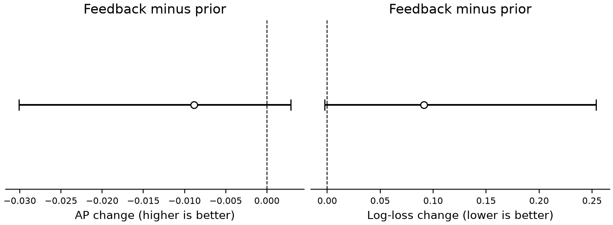

# 已付观测对未访问区域的增量预测诊断

2026年11月3日。接续Claude已完成的计算，补完实现复核、主比较重算和结果整理。**当前模型与特征未建立稳定的反馈增量收益，停止据此设计新更新器。** 这不是对所有观测或所有方法的否定。

## 主结果

固定同一批灾后静态路线的付费前缀，用两个事件拟合、第三个事件评分，循环三次。只比较“公开灾前/灾后线索”和“相同线索＋已付预测”。主要目标为未访问格是否存在固定模型可正确检出的严重损伤像素。

| 指标 | 仅线索 | 线索＋已付反馈 | 方向 |
|---|---:|---:|---|
| AUROC ↑ | 0.4997 | 0.3302 | 下降 |
| AP ↑ | 0.0343 | 0.0254 | 下降 |
| Log loss ↓ | 0.2269 | 0.3182 | 变差 |
| Brier ↓ | 0.04315 | 0.04236 | 略有改善 |
| 下一格命中／存在机会的状态 | 18/42 | 18/42 | 未变化 |

AP增量的条件自助区间为[-0.03008, 0.00288]；Log-loss增量为[-0.00252, 0.25382]。区间通过按影像对重采样既有预测获得，**没有重新拟合模型，不能代表对新事件的泛化置信区间**。分事件结果与全部分数见JSON。

## 复核发现及处理

1. Claude的计算已结束，原始八组结果完整保存在v1；先前因服务错误没有完成中文说明。原代码7项测试通过。
2. 原AP按排列顺序逐项累计，同分时会受行顺序影响。例如两个样本标签为[1,0]且分数都为0.5，原函数返回1，按阈值合并并列分数应为0.5。新增4项测试核验此修正。主比较AP点值基本不变，但部分原始排序基线和自助区间发生变化。
3. 原置换反馈在分折之前全局分配，三次事件留出中分别有56、56、57个训练前缀借用了留出事件的观测。虽然没有借用标签，但这属于跨折特征信息，不作为严格事件隔离的负对照。此次没有修改置换规则或利用新对照追求通过判定。
4. 粗图效用和旧邻域分数未经概率校准；复核版仅报告其排序指标，不把它们的Log loss/Brier解释为概率质量。
5. 重拟合保留原特征、L2强度、划分和训练方式。六次拟合均正常收敛，原主比较的AUROC、Log loss和Brier已重现。原始v1代码与结果未覆盖；本版仅审计主比较，不声称八组结果均已修正。

## 样本与范围

36对旧开发影像，共169个观察前缀、2,217个未访问格记录。同一格可在不同前缀重复出现，78个阳性记录只涉及全缓存中的28个不同真阳性格，不是78个独立目标。三个事件分别只有9、0、2幅影像存在可检出的严重像素，事件级统计功效很弱；下一格命中也只按尚有机会的状态计算，不能写成总体成功率。

模型训练使用训练事件的发布参考，评分使用留出事件参考；特征只读取公开线索及付费前缀内的预测。没有新增感知推理、标注、GPU或无人机数据，结果仍是反复使用的数据上的开发诊断，尚非独立验证、路线收益或真实飞行结果。

## 对后续工作的判断

这轮完成了此前尚未执行的“真实缓存是否有可利用反馈”的检查。现有结果不足以把当前反馈特征作为新在线更新器的依据；不恢复已停止的邻域、同建筑保底或一标准差触发器，也不修改通过阈值追分。

下一阶段应先改变可用信息条件：落实新的事件/区域、可核验的语义关联或真实多视角数据，再用独立场景检验。若暂时拿不到数据，则保留现有基线、受控信息价值分析和本轮负结果，与老师讨论是否将研究范围限定为受控规划方法；不能将同一批数据上继续调模型当作新的确认结果。

[Claude原始结果](../disaster_route_feedback_increment_v1/summary.json) · [复核摘要](summary.json) · [逐格分数](primary_scores.json) · [审计范围](scope.json) · [核验](audit.json)
