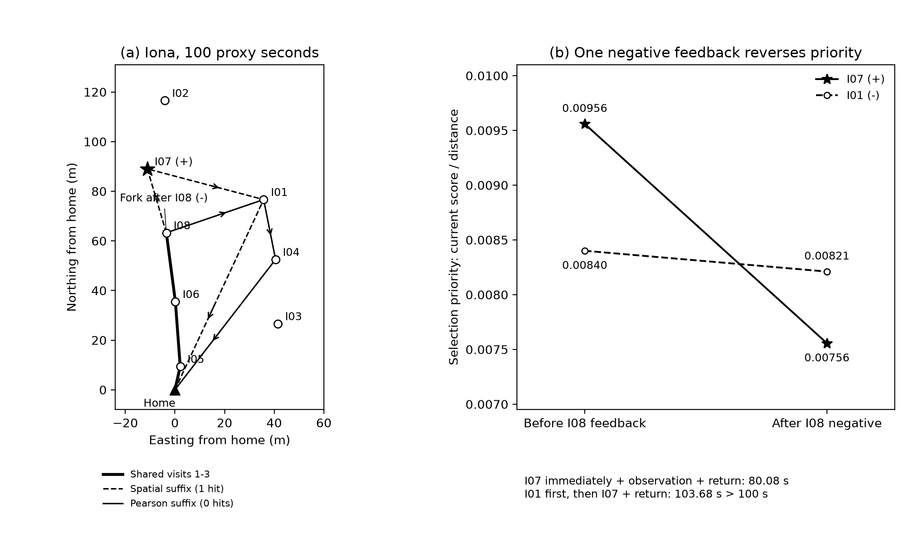
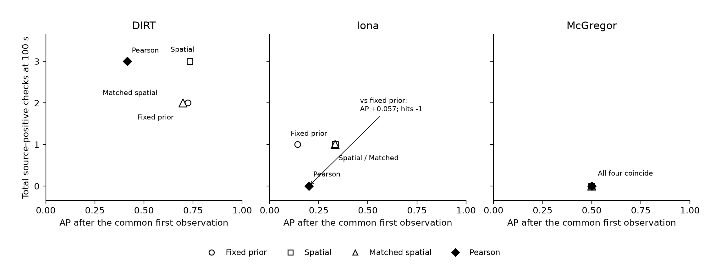

# 四层实验资产：证据与轻量复现

2026-11-05。整理已有结果，收敛结论与复现入口；未写论文、未运行新模型或新路线。

## 一条命令复算表格与两张图

项目根目录、已安装NumPy与Matplotlib时执行：

```bash
python work/disaster_route/reproduce_diagnostic_evidence.py \
  --output output/reproduced_diagnostic_evidence
```

仅用Python标准库复算全部汇总表：

```bash
python work/disaster_route/reproduce_diagnostic_evidence.py \
  --tables-only --output output/reproduced_diagnostic_tables
```

要求新输出目录。图表依赖可用`python -m pip install -r requirements-diagnostics.txt`安装。无影像、权重、GPU、API需求；只从存档逐世界期望、目标分数与访问日志重算，不能称完整重跑原感知或路线实验。

## 四层结果入口

|层次|原实验脚本|本次重算文件|事实与边界|
|---|---|---|---|
|1 受控机制|`run_verification_screen.py`|`controlled_counts.csv`|强制校准60/108更差，可选11/108改善；非灾害发生率|
|2 小VLM／表征|`run_boone_context_experiment.py`|`boone_prediction_metrics.csv`、`vlm_direction_diagnostic.csv`|历史AP0.342<0.377，12/12同向；低阶核未超幅度控制|
|3 局部与单点|`run_boone_structure_check.py`、`run_boone_two_step.py`|`boone_topk_node_sensitivity.csv`、`boone_two_step.csv`|Top-1 9:1，去B03后3:1；两步8:5非同航程|
|4 区域外同预算|`run_crasar_pearson_isobudget.py`|`external_routes.csv`、`external_budget_totals.csv`|100秒静态5、纯空间4、Pearson3；三地开发诊断|

原脚本均在`work/disaster_route/`，原结果在对应已封存目录。[结论核验与边界](结论核验与边界.md)明确区分事实、推测与过度结论；受控筛选不改称新理论，负结果不升级为“视觉全部无效”。

## 资源与实测时间

原Boone VLM使用本机Apple MPS：276次前向329.61秒，正式运行348.71秒。外区域先验也使用MPS：32次前向14.37秒。均无API费用或GPU租赁，但用了本机GPU，不能写全部CPU。权重下载、影像取得、旧感知与安装时间不在上述前向时间内。

本次CPU公开快照复现约0.51秒，标准库表格模式约0.02秒；不含安装和解释器启动。完整模式9个数值文件、4个图形文件与原工作区逐字节一致；另一Python版本的标准库表格结果在1e−10容差内一致，浮点末位差异如实记录。见[复现核对](public_reproduction_check.json)与[资源记录](resources.json)。不承诺任何机器含安装都能在5分钟内完成。

## 诊断图与检查





282项统计核对一致；图表审计另核对48项指标、5个分叉候选与超预算条件。见[汇总](summary.json)、[执行与输入哈希](execution.json)、[图表审计](figures/audit.json)。PNG及可编辑文字SVG均保留。

原始实验仍需原影像和模型环境；本包只解决快速复算已发布统计与两张诊断图。下一项根据[结论核验与边界](结论核验与边界.md)确定研究定位，写稿继续后置。
