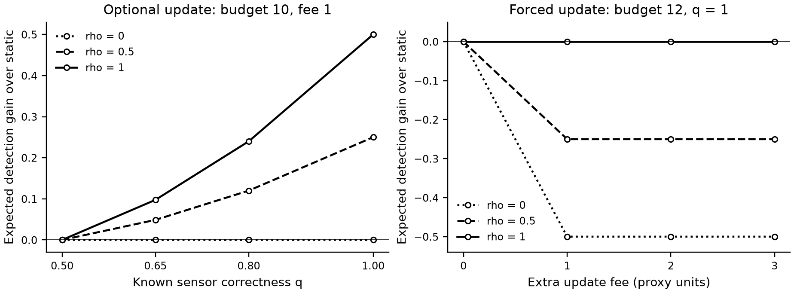

# 局部巡查中在线重规划的受益条件

2026年11月2日。新增一项与巡查奖励对齐的精确受控实验：**付费观察即完成当地巡查，不再到另一个目标位置领取奖励。** 目的是分清反馈信息与额外规划费用的作用。它使用3个合成候选点、已知联合分布和已知传感误差，不是无人机实测或新的规划方法。

## 本轮结果

同一组候选点、相同初始边际概率下，仅改变目标间的信息关联、传感正确率和重规划费用。奖励为正确检出的目标数的期望，不是实际建筑数或xBD召回率。

| 预先指定条件 | 预算 / 额外规划费 | 静态 | 强制一次更新 | 已知模型下静态或一次更新择优 |
|---|---:|---:|---:|---:|
| 独立目标，完美观测 | 10 / 1 | 1.00 | 1.00 | 1.00 |
| 强关联目标，完美观测 | 10 / 1 | 1.00 | 1.50 | 1.50 |
| 强关联目标，无信息观测 | 10 / 1 | 0.50 | 0.50 | 0.50 |
| 独立目标，费用挤占观察 | 12 / 1 | 1.50 | 1.00 | 1.50 |
| 强关联目标，费用增加 | 10 / 2 | 1.00 | 1.00 | 1.00 |

完整参数网格为720个条件、4种对照，共2,880项策略期望值，独立穷举重放122,400个带概率分支。6项针对性单元测试通过，预算违规为0。288个无信息条件下，反馈相对同费用静态对照的收益均为0；254个条件中，强制更新低于原静态路线。条件数量仅描述本合成网格，不能解释为真实灾害中的发生率。

左图固定预算10和额外费用1：关联及正确率影响信息收益。右图固定预算12和完美观测：额外费用可能减少可完成的有效观察。两图预算不同，不能跨图直接比较数值。

## 四种对照为何需要保留

- **静态**：初始规划收费1，执行固定闭合路线。
- **静态但额外收费**：没有反馈收益，却承担同样额外费用；只用于隔离成本影响。
- **强制一次更新**：首次付费观察后，根据实际收到的局部结果选择剩余路线，并支付额外规划费。
- **已知模型择优参考**：从静态和上述一次更新中选期望更高者。它事先知道正确的联合分布与传感模型，不能称为学得的门控方法，也不是任意多次重规划的最优值。

移动采用曼哈顿距离，每次观察收费1，起终点相同；所有移动、观察、规划及返回均计入预算。只有已观察位置的结果可以影响后续行动。世界真值只进入执行和独立评分器。先验层提供分布，证据层保存已付观测；本轮不把两层组织本身作为算法收益。

## 可以形成的机制解释

在一个更严格的简化设定中，若各候选点的局部观测与任务奖励相互独立、先验分布已知、旅行费用确定、收益为一次性可加的期望检出量，观察已访问点不能改善未访问点的分布。此时无额外收费的最优静态路线已达到在线策略可取得的最优期望值；额外非负更新费不会创造收益。证明与适用边界见[理论说明](理论说明.md)。这是条件性分析，不宣称新定理，也不据此认定真实灾损独立。

因此，后续方法需要先回答：实际收到的预测，究竟能改变对哪些未访问点的判断？本轮强关联收益来自明确写入的合成关联，不能移植为真实灾损的默认参数。

## 下一步只优先补一个真实数据诊断

**检验加入已付观测后，对未访问格的判断是否优于只使用公开线索。**

1. 保持感知器固定。免费输入仅用既有灾前纹理、灾后粗变化；观测输入仅用已付前缀里的预测，不读取未访问预测。
2. 固定同一批观察前缀，比较“仅先验特征”和“先验＋已付反馈”的小型预测器。主要目标为未访问格是否存在固定模型真阳性；严重参考存在性另报，以区分路线机会和感知漏检。
3. 按影像对、事件隔离拟合与评分，保留无目标与失败事件。既有36对已经用于开发，即使交叉验证也只作为开发诊断，不能升级为独立验证。
4. 若加入观测没有增量预测价值，就停止以该信息源设计新的在线更新器。若有，再研究收益是否足以抵消移动、观察和重规划费用。

这一诊断可用CPU与现有缓存，不需要补造无人机视角。未来仍需独立数据确认。原邻域传播、同建筑保底及一标准差触发器的负结果保留，不通过本实验恢复旧规则或重调阈值。

移动与传感的联合预算已有[AIPPMS](https://arxiv.org/abs/2003.09746)研究；用反馈修正语义先验已有[Search-TTA](https://arxiv.org/abs/2505.11350v5)。本轮新增的是与本项目巡查收益一致的可核验分析工具，尚未建立可发表的方法贡献。

[固定协议](protocol.json) · [摘要](summary.json) · [完整记录](results.json) · [数据表](results.csv) · [核验](audit.json)
