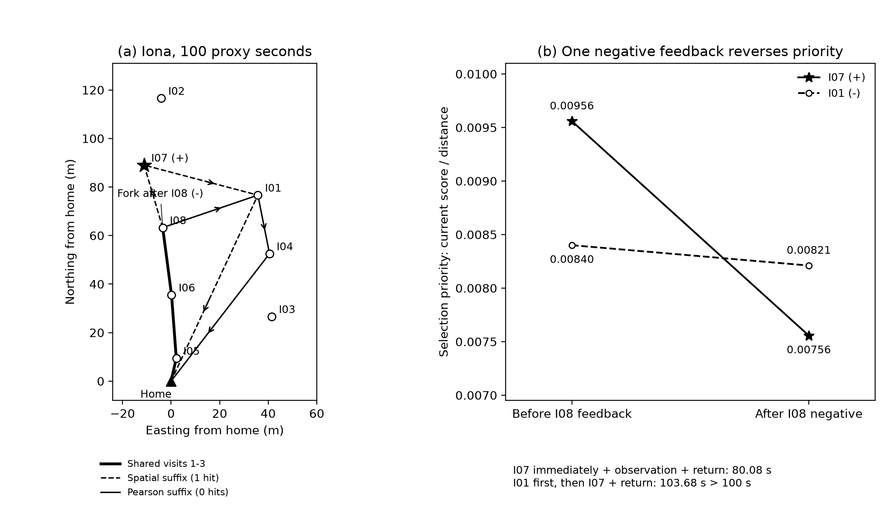
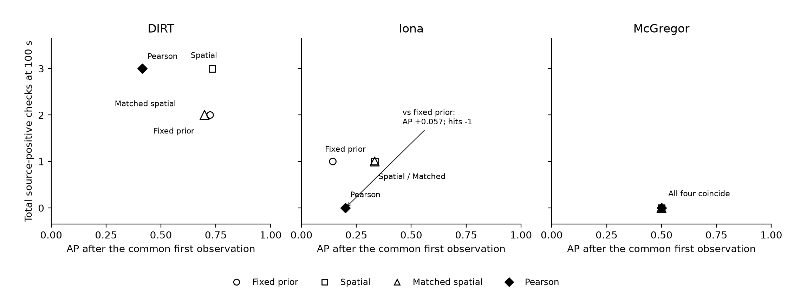

# Iona轨迹解剖与排序—路线收益诊断

2026-11-05。仅分析已有JSON日志，生成两张黑白诊断图；没有修改算子、运行新路线、调用模型或撰写论文。旧实验结果保持不变。

## 1. Iona：第三次阴性反馈后，目标顺序反转

100代理秒下，纯空间与幅度匹配空间走相同路线，命中1；Pearson命中0。精确静态在该预算也是0，不能写成“静态命中1”。局部编号I01—I08按该区域建筑ID排序，映射见[编号表](iona_local_id_map.json)。

- 纯空间：Home→I05→I06→I08→**I07（阳性）**→I01→Home，223.71m，99.74s。
- Pearson：Home→I05→I06→I08→I01→I04→Home，196.19m，95.24s。

两者前三次访问完全相同，且均为阴性。第四次选点时已经支付I08观察与当次决策费用，用时46.76s。Pearson应用I08阴性反馈后的两个关键候选为：

|候选|距I08|与I08的特征相似度|更新前分数|更新后分数|更新前分数／距离|更新后分数／距离|
|---|---:|---:|---:|---:|---:|---:|
|I07，阳性|26.87m|0.41371|0.256807|0.203012|0.009559|0.007556|
|I01，阴性|41.43m|0.07386|0.348064|0.340192|0.008401|0.008211|

I08的负残差为−0.300451。I01与其更不相似，因此扣分仅0.007872；I07扣分0.053795。**门控对I01的保护更强，导致I01优先级反超I07。** 纯空间在同一分叉点给I07的绝对分数甚至更低（0.165195），但I01也更低（0.213058），两者除以距离后仍优先选I07。因此问题不能简化为“Pearson把阳性绝对分数压得比空间更低”。

当下直接访问I07、观察并返程，结束时间为80.08s；先访问I01后，再访问I07并返程，则需要103.68s，超预算3.68s，I07被排除。Pearson最终路线反而更短、总耗时更少；失败体现为**访问顺序与返程可行集合的相互作用**，并非总航程更长。



图右只回看同一日志状态在最后一次更新前后的优先级：若这次不应用I08更新，最高优先级是I07；应用后是I01。没有生成替代完整路线，不把这一局部回看包装成新策略实验。这里定位的是已冻结算子的计算机制，不证明影像中误差由何种物理原因造成。

## 2. 排序指标与闭合路线命中不单调对应

散点图统一取**各区域完成同一栋首访之后、第二次选点之前**的分数，计算其余已知标签建筑的AP。固定先验、纯空间、幅度匹配空间、Pearson四种规则在每个区域均有相同的首访、付费历史和时间点；未知标签从排序评价中排除。纵轴为对应100秒闭合路线总命中，包含各方法相同的首访奖励；另存扣除共同首访后的命中数。

|区域与比较|首访后AP变化|100秒路线命中变化|
|---|---:|---:|
|Iona：固定先验→Pearson|0.142857→0.200000|1→0|
|DIRT：固定先验→Pearson|0.724126→0.415892|2→3|
|McGregor：四规则|均0.500000|均0|



图中共有3区域×4规则=12个相关诊断点，按区域分面，不混合阳性基数、不拟合总体相关系数或作独立样本显著性检验。NDCG@3和Top-1也一并导出：例如DIRT固定先验NDCG@3为1.000，Pearson为0.235，但路线命中仍由2变3。现有反例支持“该静态排序截面的提升不足以保证路线收益提升”，不支持“AP普遍无用”或“排序与收益统计独立”。

精确静态起始路径与观测历史可能不同，因此不塞进同首访散点比较；它的强对照结果仍保留在原54条路线报告中。Boone的单锚点平均AP也不与外区域的100秒路线强行配对。首次反馈后的AP只是一个截面，后续反馈和几何费用仍会改变决策；因此图本身不构成通用因果效应估计。

## 复现与文件

已有NumPy、Matplotlib时，在项目根目录执行：

```bash
python work/disaster_route/diagnose_iona_ranking_route.py \
  --output output/iona_ranking_diagnostic_reproduced
python work/disaster_route/audit_iona_ranking_diagnostic.py \
  --output output/iona_ranking_diagnostic_reproduced
```

第一个命令要求新输出目录。本机生成两图及统计约0.2秒，不含环境安装与Python启动；无需原始影像、模型权重、GPU或API。缺依赖时安装`numpy`与`matplotlib`即可。PNG供查看，SVG保留矢量图与文字。

- [Iona完整分叉记录](iona_fork.json)／[全部可行候选CSV](iona_candidates_at_fork.csv)
- [12点AP、NDCG、命中、距离和时间](ranking_route_points.csv)／[区内配对差值](within_region_comparisons.json)
- [轨迹图SVG](iona_fork.svg)／[散点图SVG](ranking_route_scatter.svg)
- [输入哈希与指标定义](execution_recipe.json)／[独立数值核验](audit.json)

独立核验48个指标与命中量、5个分叉候选的更新及103.68秒排除条件；原同预算实验132个封存文件哈希不变。公开快照中的64张历史切片可缺省且有清单披露，不影响本次日志诊断。已在公开快照目录单独复跑，9个数值／图形文件与本地逐字节一致，见[公开快照复现核对](public_reproduction_check.json)。

当前只补分析证据。研究主方法与写稿安排均未由这两张图自动升级；Pearson继续作为冻结对照。
