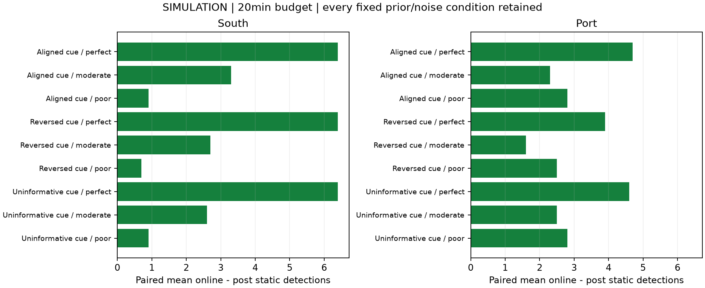
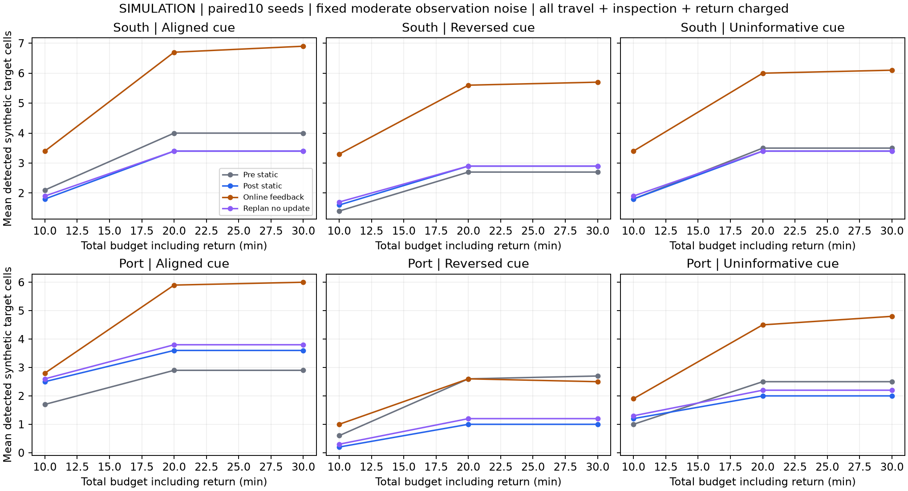
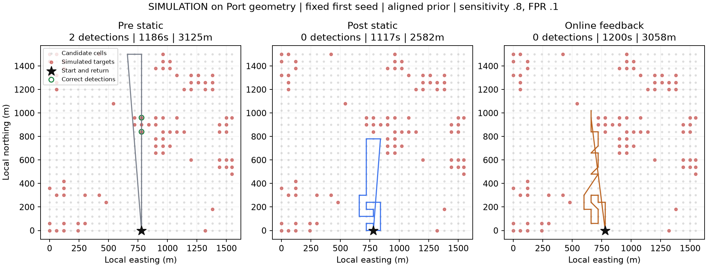
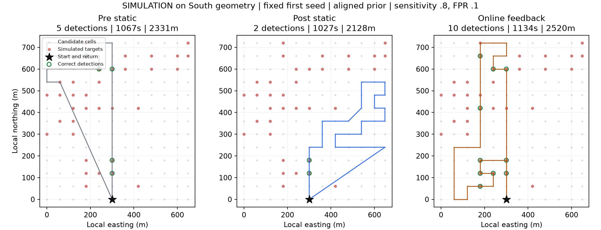
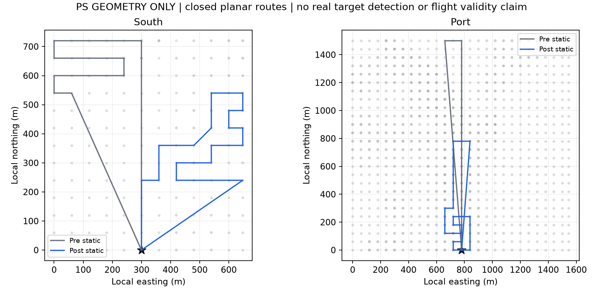

# 灾前灾后巡查路线闭环第一轮实验

协议于2026-10-28冻结；2026-11-01接续完成核验与整理。已把已有PS静态演示接成含移动、观察、返程和规划延迟的闭环实验；感知检查归档保留，本轮没有继续追识别精度。**路线执行与预算核验已完成，目标发现效果目前只在清楚标记的合成仿真中测量。**

## 主线与三种路线

1. 灾前静态：只用几何和均匀热点先验形成固定巡查路线。这是最小灾前基线，尚未接入真实建筑暴露/人口图，不能称为完整灾前风险规划。
2. 灾后一次性：读取已有PS变化线索构成的固定先验，用同一个求解器一次性生成闭合路线；沿途记录观测，但不改变路径。
3. 在线重规划：初始信息和灾后一次性相同，每次付费观察后按固定噪声模型更新当前空间块信念，重算剩余可行路线并走第一步。

另保留“重算但不更新信念”控制，用来区分观测更新和单纯重算/额外规划成本。在线不是保证更优的新方法；这里是一个可检验的基线。核心求解器统一为“期望目标概率/移动加观察时间”的贪心启发式，不宣称路线全局最优。

## 路线成本与可行性

口岸、南侧建筑区分开运行，不跨两裁切之间的空隙连线。所有方法共享每区同一起终点、5m/s、每格20s、最多30次观察。时间预算600/1200/1800s，主预算1200s。每次选择都为回到起点预留时间，返程包含在最终总距离和耗时中。

规划延迟固定为仿真1s/次：静态付一次，在线每次执行重规划付一次；它是实验假设，不是无人机上的实测延迟。求解器实际CPU耗时另报，不混入仿真1s。总时钟等于移动＋观察＋已付规划延迟，全部记录在逐步轨迹中。

本轮2160条仿真路线预算均可行；独立核对53552次付费观察及全部返程。在线规划接口只接收公开几何、当前信念和已观测的一位反馈，不能查询未访问目标或未来观测。静态策略也获得同一模拟观测流，但按定义不用于改路。

## 感知固定与仿真边界

真实感知器保留既有Strong Baseline事件划分检查点，不更换权重、不训练、不新增图像推理。路线仿真采用固定模拟观测器，灵敏度/误报率分别为理想1/0、中等.8/.1、较差.6/.25。它们不是从遥感像素精度倒推的无人机性能，也不是新的实测感知成绩。

模拟目标格与观测存于单独的 `synthetic_worlds.json`；没有写入既有PS真实目标空表。3×3网格共享隐藏热点状态，用于构造有空间相关性的合成环境。灾后变化分数仅通过预先固定的块排名构成.05–.35热点概率，未知块.2；**这个变换仅用于仿真，不表示变化分数已经校准为真实灾损概率。**

先验正确、先验顺序反向、先验无信息三个环境各10个固定种子，两个区域共60个目标场。每个目标场的目标、观测随机数在方法、预算和噪声条件间共享。模型正确且似然已知的条件本来更利于Bayes更新，所以不能只展示它。反向和无信息条件、所有失败与无发现轨迹均保留；10种子并不是10次真实灾害复验。

详细指标、全部主预算负例与后续优先级见 [结果复盘与下一步](结果复盘与下一步.md)。

## 同预算的结果

主预算1200s下，18个区域/先验/噪声条件的在线减灾后静态平均发现数：正向18个、相同0个、负向0个。它是全部仿真条件的计数，不是显著性检验或跨灾害效果证明。

下表显示中等噪声、1200s的三种主路线，所有区域和先验条件都保留。发现单位为合成目标格；首次正确发现时间在未发现时原值为null，并明确计入失败率。表中的“首次发现或预算”对失败填预算1200s作为受限时间指标，越小越好；不能把失败填0或只比较成功者的时间。

| 区域 | 仿真先验 | 路线 | 平均发现目标格 | 首次发现或预算 秒 | 无发现率 | 往返米 | 总耗时秒 |
|---|---|---|---:|---:|---:|---:|---:|
| 南侧建筑区 | Aligned cue | online | 6.70 | 253.0 | 10% | 2810 | 1181.6 |
| 南侧建筑区 | Aligned cue | post_static | 3.40 | 355.8 | 20% | 2128 | 1026.5 |
| 南侧建筑区 | Aligned cue | pre_static | 4.00 | 238.6 | 0% | 2331 | 1067.2 |
| 南侧建筑区 | Uninformative cue | online | 6.00 | 253.0 | 10% | 2807 | 1180.9 |
| 南侧建筑区 | Uninformative cue | post_static | 3.40 | 355.8 | 20% | 2128 | 1026.5 |
| 南侧建筑区 | Uninformative cue | pre_static | 3.50 | 238.6 | 0% | 2331 | 1067.2 |
| 南侧建筑区 | Reversed cue | online | 5.60 | 290.1 | 10% | 2824 | 1180.0 |
| 南侧建筑区 | Reversed cue | post_static | 2.90 | 355.8 | 20% | 2128 | 1026.5 |
| 南侧建筑区 | Reversed cue | pre_static | 2.70 | 238.6 | 0% | 2331 | 1067.2 |
| 口岸 | Aligned cue | online | 5.90 | 470.6 | 30% | 2912 | 1176.6 |
| 口岸 | Aligned cue | post_static | 3.60 | 498.4 | 20% | 2582 | 1117.5 |
| 口岸 | Aligned cue | pre_static | 2.90 | 324.5 | 10% | 3125 | 1186.0 |
| 口岸 | Uninformative cue | online | 4.50 | 697.6 | 40% | 2926 | 1183.7 |
| 口岸 | Uninformative cue | post_static | 2.00 | 831.7 | 50% | 2582 | 1117.5 |
| 口岸 | Uninformative cue | pre_static | 2.50 | 630.7 | 30% | 3125 | 1186.0 |
| 口岸 | Reversed cue | online | 2.60 | 796.4 | 40% | 2959 | 1184.0 |
| 口岸 | Reversed cue | post_static | 1.00 | 955.7 | 50% | 2582 | 1117.5 |
| 口岸 | Reversed cue | pre_static | 2.60 | 570.9 | 10% | 3125 | 1186.0 |

预先固定的示例是每区首种子、先验正确、中等噪声、1200s；没有挑选最好例子。下图目标全部为合成标签，只借用了PS网格几何，不应当成该地区真实灾损图。

## 真实PS几何案例

真实案例只导出灾前均匀静态与灾后线索静态的闭合几何路线，以及距离、耗时和未校准变化线索的访问汇总。没有真实观测反馈就不伪造一条“已经在线适应”的实地路线。对应 `PS_geometry_static_routes.geojson` 可在GIS中查看；它是平面巡查路线原型，未加入地形、禁飞区、障碍、转弯半径、相机覆盖和电池动力学，不能直接执行飞行。PS真实目标覆盖与首次到达目标时间维持null。

## 实现与复核

新增12项有针对性的闭环测试通过，涵盖返程预留、费用闭合、未来信息隔离、固定静态路线不受反馈影响、Bayes更新方向、无发现时间处理、世界配对与无标签公开接口。另独立重建60个目标世界，逐步重放2160条路线、216份条件汇总和162份配对对照。旧感知冻结代码及PS真实目标空表哈希不变；汇报材料仍在原处。

本机CPU执行仿真循环约5.54s，累计求解器计算约4.68s。没有网络下载、付费GPU、新训练、新感知调用或旧保留集评分。

## 下一步

先使用本轮轨迹明确在线何时改善、何时被错误反馈或转场成本拖累，核对结果是否只来自有利生成假设；不按本轮最佳条件换主预算或调噪声。路线闭环通过后，下一阶段优先把允许通行/可飞区域、合理相机观察范围或固定感知缓存接入同一个时间与位置接口，每次只验证一个新增约束。真实目标资料不足时，继续分开报告仿真机制与PS几何案例；不把仿真发现量当成实地救援效果。新颖性和论文主张尚未建立。

主要产物：`protocol.json`、`routes.jsonl`、`metrics.csv`、`condition_means.json`、`paired_comparisons.json`、`PS_geometry_static_routes.geojson`、`audit_report.json`。
