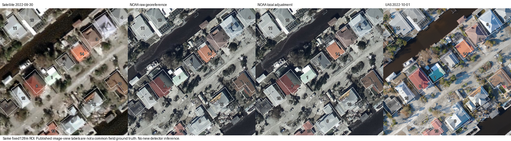

# NOAA复核入口：实际影像与研究可用性审查

2026-11-03。**实际图像入口成立；作为“可靠校准锚点／同状态无人机复访”的入口尚未成立。** 这项结果不改变上一轮停止泛化复核候选的决定。

沿用此前按元数据排序确定的Boone、原128m区域及建筑集合，不因标签或方法结果换例。实际读取NOAA三通道GeoTIFF的533行源条带，缓存21,364,736字节（原文件543,400,290字节）；未下载完整影像。全部原16栋区域内建筑中心都有NOAA对应ID，原12栋完整可用建筑在NOAA影像中也全部有非黑像素支持。没有新增模型推理或训练。

## 核验发现

|项目|结果|可支持的结论|
|---|---|---|
|影像支持|原12栋可用建筑支持比例均100%|这里确有可读取的额外图像；不等于无遮挡或能判清损伤|
|作者目录日期|灾前卫星2022-01-21；灾后卫星和NOAA均09-30；UAS10-01|有跨源时间关系；没有精确拍摄时刻、目标状态稳定性证明或飞行记录|
|NOAA／卫星视角标签|12栋已知标签中2栋不同|存在标注／可见证据差异，不能指定哪一方正确|
|NOAA／UAS视角标签|12栋已知标签中1栋不同|仍不能分离真实变化、遮挡、配准、判读差异与检测错误|
|共同现场真值与校准模型|未提供／未建立|不能将NOAA当成无误差教师，不能直接估计可靠漏检率|

标签对照是作者影像视角标注，不是新检测器输出：卫星4栋minor中，NOAA有2栋minor、2栋no damage；UAS3栋minor中，NOAA有2栋minor、1栋no damage。没有把多数意见当真值，也没有用这些标签作为免费Agent输入。该小区域不含严重损伤目标，不能评价严重搜查收益。

## 配准结果不宜简化成“已通过”

保留原地理变换和作者局部修正两种NOAA显示，不按损伤结果或匹配得分选择版本。固定SIFT诊断中，卫星到NOAA中位直接残差从约1.28m变为2.02m（分别42／35个平移一致匹配）；UAS到NOAA从约4.43m变为1.61m（8／6个一致匹配）。灾前卫星到NOAA未得到足够一致匹配。

这些是局部自动匹配诊断，不是独立地面控制点或测绘精度。作者局部修正并未对两组关系一致改善，不能把它当成自动通过配准门槛的证书。保留两版本不表示补造第二次观测。

## 研究结论与止损

这个来源可以进入**档案跨源证据访问**的候选资料，但还不能验证“先验错误还是检测器漏检”的因果归因，更不能充当上一轮小模型里返回世界身份的校准信号Q。独立取得的图像也不自动具有独立误差。

作者的[跨源损伤标注审计](https://arxiv.org/abs/2505.08117)已指出卫星／无人机标签不一致的现实问题；这不是我们新发现的研究空白。其[实际部署记录](https://arxiv.org/abs/2506.15890)也明确列出分辨率、配准和连接等问题，不能靠再添加一张正射影像就视为消除这些条件。

**本轮既定数据入口检查到此结束，不新增路线运行或感知训练来延长已停止候选。** 当前仍没有可主张的新方法贡献。恢复物理复核方向，需要同建筑、时间相容的独立采集，能够支持共同损伤参考或观测模型校准，并且先明确区别于已有方法的新命题。资源不足时，应与老师讨论把实证范围明确收缩到档案证据访问，或更换候选；不能把该收缩本身写成创新。

检查证据：100个源像素用缓存中的未压缩条带字节独立核对，1000个插值样本与独立双线性计算核对，全部所需条带存在；旧3237个封存文件哈希不变。插值容差仅用于8位像素数值验证，不是空间配准容差。详见[audit.json](audit.json)、[决策记录](decision.json)及[来源元数据](source_metadata.json)。
