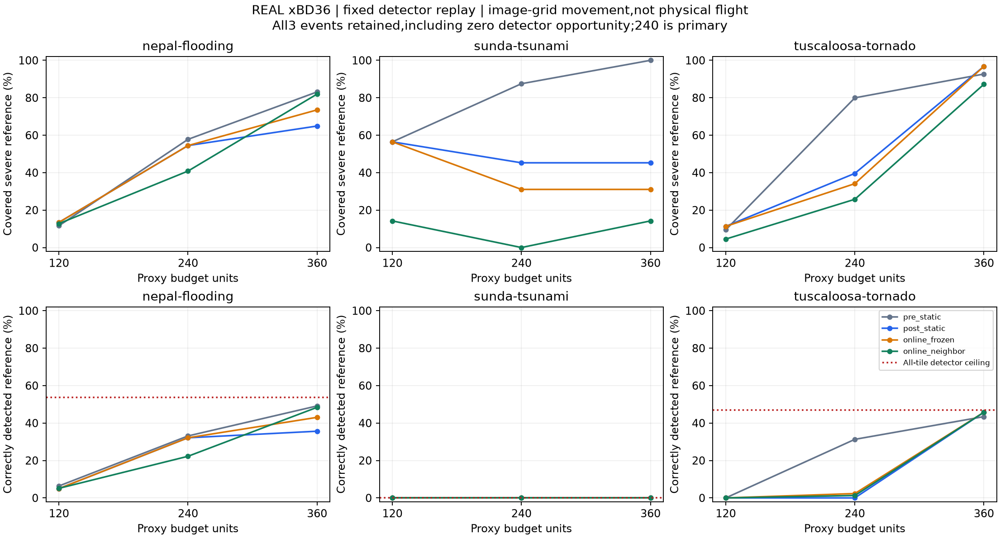

# 真实xBD36：双层地图Agent的路线回放

2026-11-02。[打开真实数据回放](demo.html)，[查看现实需求评估与下一步](现实需求评估.md)。此页面需保留相邻assets目录。全部36对真实前后影像、固定模型的576块预测及发布语义参考来自既有缓存；没有随机生成目标、随机误检漏检、新训练或新模型推理。每幅影像是独立任务，不能将36块散布影像拼接成连续灾区航线。

## 能说明什么

这轮检验真实灾前/灾后图像线索、真实识别误差、付费观察与路线选择的关系。浏览器先前的合成例只证明接口可运行，尚不能满足真实部署需求；本轮也仍是影像网格回放，不是实际无人机、地面搜救或真实通行实验。

第一层由64像素粗图构造灾前纹理代理和灾后变化排名，二者均非已校准灾损概率。第二层只在支付移动及观察成本后写入固定模型的局部严重预测数量。在线邻域反馈是未经调参的4邻域简单基线；同时保留相同重算但无传播对照。发布参考标签只供评价，不参与路线决策。

两种双层组织继续共享信息：先验/线索＋沿途证据；或几何代价＋语义搜索状态。切换组织不自动改变路线，不作为新方法收益。

## 240主预算结果

| 事件 | 策略 | 覆盖严重参考 | 正确检出严重参考 | 平均观察格 | 平均规划次数 |
|---|---|---:|---:|---:|---:|
| nepal-flooding | 灾前纹理静态 | 57.79% | 33.10% | 4.75 | 1.00 |
| nepal-flooding | 灾后线索静态 | 54.45% | 32.11% | 4.67 | 2.00 |
| nepal-flooding | 在线重算但无反馈传播 | 54.45% | 32.11% | 4.67 | 5.42 |
| nepal-flooding | 在线邻域反馈基线 | 40.84% | 22.23% | 4.67 | 5.58 |
| sunda-tsunami | 灾前纹理静态 | 87.50% | 0.00% | 4.42 | 1.00 |
| sunda-tsunami | 灾后线索静态 | 45.26% | 0.00% | 4.67 | 2.00 |
| sunda-tsunami | 在线重算但无反馈传播 | 31.04% | 0.00% | 4.67 | 5.25 |
| sunda-tsunami | 在线邻域反馈基线 | 0.00% | 0.00% | 4.25 | 5.17 |
| tuscaloosa-tornado | 灾前纹理静态 | 79.96% | 31.28% | 4.33 | 1.00 |
| tuscaloosa-tornado | 灾后线索静态 | 39.60% | 0.00% | 4.75 | 2.00 |
| tuscaloosa-tornado | 在线重算但无反馈传播 | 34.13% | 2.32% | 4.83 | 5.50 |
| tuscaloosa-tornado | 在线邻域反馈基线 | 25.77% | 1.27% | 4.33 | 5.25 |

覆盖指访问区域包含多少严重发布参考像素；正确检出还要求固定模型预测与参考重叠。海啸全部局部块的真阳性上限仍为0，路线不能补救模型完全漏检的目标。零参考场景不删除，其召回为null，另报失败率。36对是已使用开发数据，不是独立确认。

## 预算与地理限制

每幅1024图像分16个256格，起终点假设在底边中部。距离单位为256像素格宽；移动一格宽计20代理时间单位、观察20、每次求解1。预算120/240/360，240主比较，所有移动、观察、规划和返程均计费。灾前规划1计入所有方法，灾后/在线另付1修订；每次在线重算另付1。

补读了发布拍摄GSD和时间，仅新增84,672字节公共元数据，没有读取新的损伤或几何列。传感器GSD不是已经核实的PNG地理变换，故未据此报告真实米数；20时间单位也不是实测飞行时间。道路断裂、障碍、地形、禁飞、通信和真实平台约束仍缺。不能从本报告推断现场可执行性。

## 核验与复现

77项路线测试通过，其中新增10项。432条完整路线的费用、观察、效用更新和评分重放，576份模型缓存按原阈值重新解码。全36及三个事件逐一报告，不补挑阳性、不把旧SantaRosa加入救分，不在本批调邻域、权重或阈值。缓存离线生成是评测装置；在线策略只能取得已付格的预测，未访问格不免费暴露。

离线浏览器记录包含完整已执行轨迹和评价图层，界面按时间轴渲染前缀；评价参考开关不进入Agent状态。真实影像、预测、发布参考三者分开标识，发布参考不是新的人工现场真值。新增图片只是既有缓存的展示缩略图，未改变感知输入。

原始来源：[xBD论文](https://arxiv.org/abs/1911.09296)、[固定TACO版本](https://huggingface.co/datasets/isp-uv-es/xview2-taco/tree/44e219dc1d88c9d0903d6b478d7f2f3c435e574f)。数据与展示衍生材料遵循CC-BY-NC-SA-4.0；影像归Maxar Open Data，原数据归xBD作者/DIU/CMU SEI。

## 固定身份的真实影像案例

以下每事件取原选样排名第1个，不按损伤或成功程度换例。红色是仅供事后评价的发布参考，青色是图内网格路线；不把穿越河流或地形的直线当作可执行地面/飞行路径。

