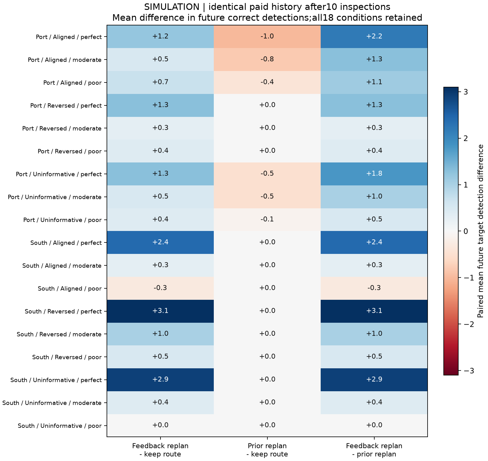
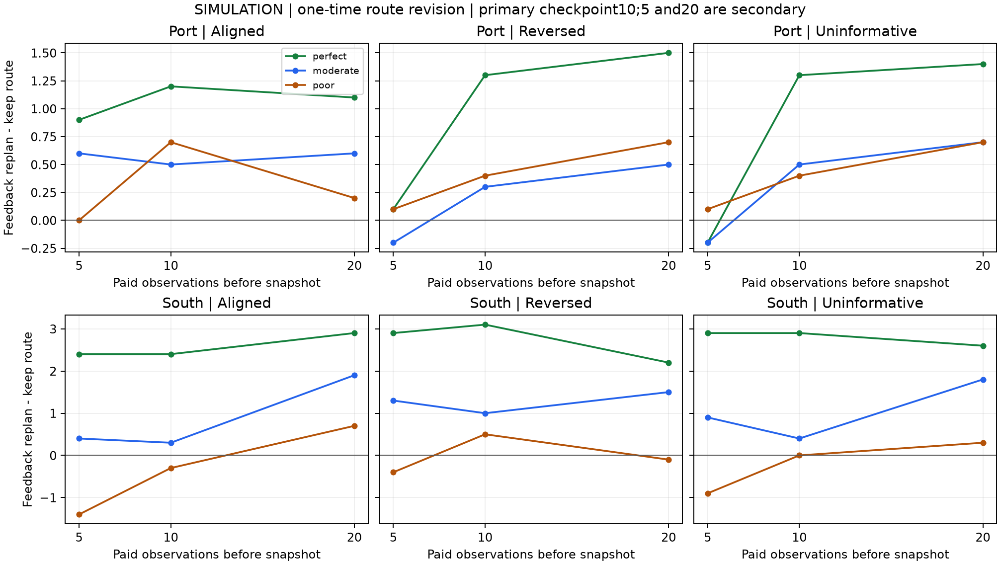
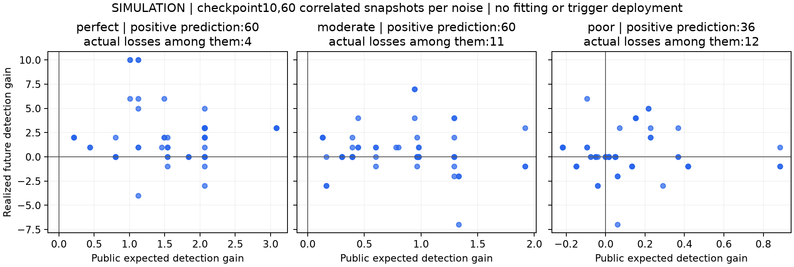
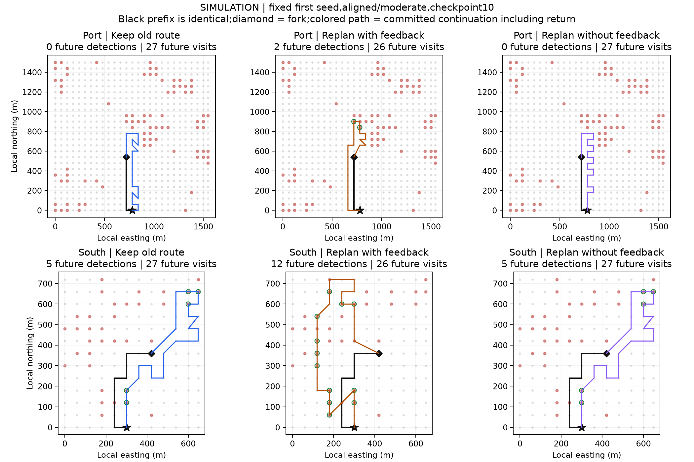

# 同状态快照分叉与一次改路的净影响

2026-11-02。受[DeepSeek DSec](https://arxiv.org/abs/2609.22978)第6.1和6.2节快照恢复、执行状态保存，以及第6.4和6.5节评测信息隔离启发。本项目将这些工程思路用于同状态路线分叉；这不是DSec提出的路线算法，也没有复现其分布式沙箱平台。

## 本轮结论

同状态分叉已经接通：三支拥有相同的已发生路径、付费历史和当时信念，后续独立执行。第10次观察后，一次反馈改路在18个条件均值中为16正、1平、1负；180个快照的实际胜/平/负为79/69/32。继续原路线的540个恢复分支均精确复现其对应原静态轨迹，共涉及180条不同父轨迹。

“重算但不使用反馈”相对继续旧路线为0个正向条件、12个持平、6个负向；180个快照为0胜、164平、16负。这说明在当前快照和求解器下，单纯重新求解没有带来平均收益。反馈重规划相对该对照为16正、1平、1负，正向空间来自使用付费历史，而非只增加规划调用；该结论不外推为所有求解器都应如此。

南侧先验正确、中等误差下，反馈改路将后续正确发现从4.4升至4.7格，但下一次正确发现的受限等待指标由约365秒变为466秒，无后续发现率由20%变为30%；较差误差下则由4.0降至3.7格。口岸先验正确、中等误差下从3.7升至4.2格。平均发现量与及时性仍需分开判断。

行动前预期增益为正的快照，理想/中等/较差误差分别60/60/36个，其中实际负增益为4/11/12个。预期值即使正确，也不保证每次随机结果获益；这些分歧本身不能证明概率校准失败。后续应检验改路的风险与收益权衡，不能仅用“期望增益大于0”声称单次改路有保证。

第5次观察时，反馈改路为11个正向条件、1平、6负；第20次为17正、0平、1负。这些状态包含不同历史和剩余预算，不能据此事后改选第20次为主点，或宣称统一晚改路更优。主点继续保持事前固定的第10次。

## 实验问题与边界

在完全相同的位置、已付成本和观测历史之后，立即修改一次剩余路线是否有净收益？本轮从强化求解器生成的灾后静态路线收集前缀，一边获得付费观测、一边记录Bayes后验，但在快照前不改路。全部60个旧合成目标场、三档误差、两个PS几何区域均保留，在第5、10、20次观察后保存JSON快照，合计540个快照、1,620条后续轨迹。第10次为主要比较点，其余两点为敏感性分析。

每个快照分三支：继续旧路线；付1秒后根据当前反馈重算一次并固定执行；付同样1秒但按原灾后先验重算一次并固定执行。第三支用于区分重新求解和使用反馈的影响。已发生的前缀直接恢复，不重走、不重观察、不重复扣费；各分支自行支付后续移动、观察、新规划和返程。

**这是一次改路的局部影响，后续不再重规划，不能与上一轮始终在线策略的效果直接等同。快照来自静态行为轨迹，也不能代表所有在线策略会遇到的状态。**

## 主比较结果

第10次观察后的18个区域/先验/误差条件，反馈重规划减继续原路线的平均正确发现格：正向16、相同1、负向1。180个快照的胜/平/负为79/69/32，仍是共享世界上的描述统计。

| 区域 | 先验 | 误差 | 后续正确发现增量 | 快照胜/平/负 | 后续往返距离增量米 | 后续观察数增量 |
|---|---|---|---:|---|---:|---:|
| 南侧建筑区 | Aligned | moderate | +0.3 | 4/4/2 | +67 | -1.2 |
| 南侧建筑区 | Aligned | perfect | +2.4 | 6/3/1 | +95 | -1.2 |
| 南侧建筑区 | Aligned | poor | -0.3 | 3/4/3 | +82 | -1.2 |
| 南侧建筑区 | Uninformative | moderate | +0.4 | 3/4/3 | +67 | -1.2 |
| 南侧建筑区 | Uninformative | perfect | +2.9 | 7/3/0 | +95 | -1.2 |
| 南侧建筑区 | Uninformative | poor | +0.0 | 2/4/4 | +82 | -1.2 |
| 南侧建筑区 | Reversed | moderate | +1.0 | 5/3/2 | +67 | -1.2 |
| 南侧建筑区 | Reversed | perfect | +3.1 | 8/2/0 | +75 | -1.0 |
| 南侧建筑区 | Reversed | poor | +0.5 | 2/4/4 | +82 | -1.2 |
| 口岸 | Aligned | moderate | +0.5 | 5/4/1 | +60 | -1.3 |
| 口岸 | Aligned | perfect | +1.2 | 7/2/1 | +32 | -1.1 |
| 口岸 | Aligned | poor | +0.7 | 5/3/2 | +23 | -1.1 |
| 口岸 | Uninformative | moderate | +0.5 | 3/6/1 | +86 | -1.6 |
| 口岸 | Uninformative | perfect | +1.3 | 6/3/1 | +20 | -1.0 |
| 口岸 | Uninformative | poor | +0.4 | 3/5/2 | +84 | -1.7 |
| 口岸 | Reversed | moderate | +0.3 | 2/6/2 | +96 | -1.6 |
| 口岸 | Reversed | perfect | +1.3 | 5/4/1 | +24 | -1.0 |
| 口岸 | Reversed | poor | +0.4 | 3/5/2 | +84 | -1.7 |

主指标只计算快照之后新发现的合成目标格。已经在前缀发现的目标不再记入后续奖励。下一次正确发现的等待时间在失败时保留null；受限时间指标填快照时的剩余预算，并另报无后续发现率。原始总路线、覆盖、误报、距离和时间均保留。

## 预期增益与实际增益

行动前的预期发现数由当前公开后验与已知模拟灵敏度计算，不读取未来观测或真值。下表仅检查预期增益为正时是否仍出现实际负增益，没有据此拟合阈值或宣称触发器有效。

| 误差 | 主快照数 | 预期增益为正 | 其中实际负增益 |
|---|---:|---:|---:|
| perfect | 60 | 60 | 4 |
| moderate | 60 | 60 | 11 |
| poor | 60 | 36 | 12 |

示例按事前规则固定为每区第一种子、先验正确、中等误差、第10次观察后分叉，没有换成有利轨迹。红点为合成目标，黑色已发生路径在三支完全相同，彩色为各自后续路线。

## 接口与验证

新增`Session`提供付费step、JSON快照、完整状态恢复和独立后续执行。公开状态包含位置、预算账本、观察历史、信念、剩余路线；环境侧保存不可变世界引用和已观察游标。恢复同时核对快照哈希、环境指纹、历史费用和后验，分支之间不共享可变游标。完整快照需要可信环境注册表来解析世界引用，不是操作系统进程快照。

策略接口只接收公开状态副本和公共几何。目标真值、未访问观测和评价分数只由模拟环境与评分器使用。本轮为固定Python策略的接口隔离，尚未建立可执行恶意代码的进程/文件沙箱。

39项测试通过，其中新增16项。540个继续原路线分支精确复现180条原静态轨迹的动作、时间、距离与发现结果。所有快照和1,620条分支均经过独立账本、观测、后验、未来奖励及汇总核验；规划选择使用未改动的上一轮求解器按重建的公开输入复算。

本机CPU循环约3.05秒，后续规划累计实测约0.38秒。没有新影像下载、感知推理、训练、付费GPU或真实标签。

全部快照、条件、前缀和旧世界之间存在相关性，540不是540次独立灾害；数据仍为已用开发数据。已知3×3热点结构、已知模拟误差率与平面移动假设保持。真实PS目标收益、物理飞行有效性与新策略贡献仍未建立。

## 后续关口

先利用同状态差值确定改路收益及风险是否能被当时可用信息预测，再固定一个简单的触发规则。规则确定后，另立前瞻的新实例与在线行为状态检验；当前快照不能同时用来挑规则和报告独立确认收益。预测值为正不等于实际保证收益，后续移动已按路径计费，不再重复惩罚同一转场距离。
