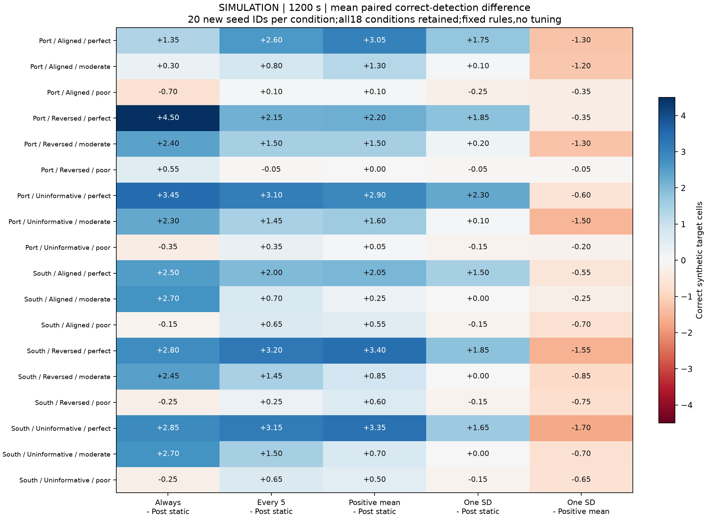
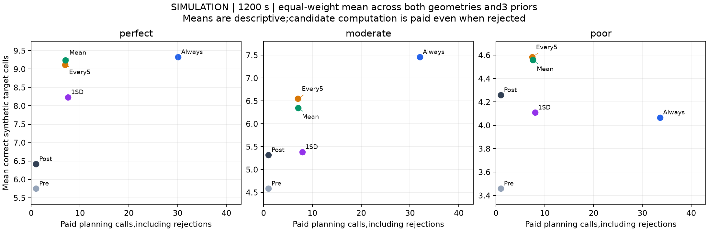
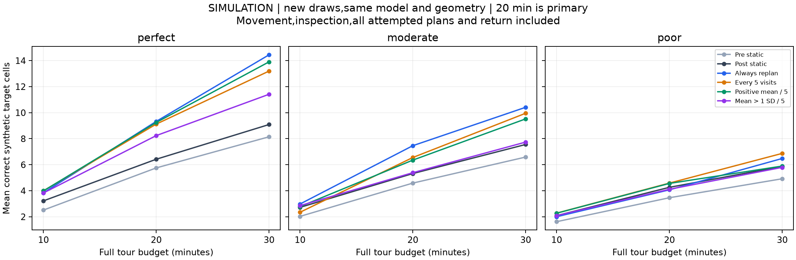
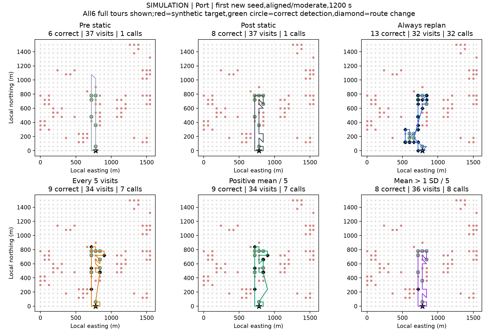
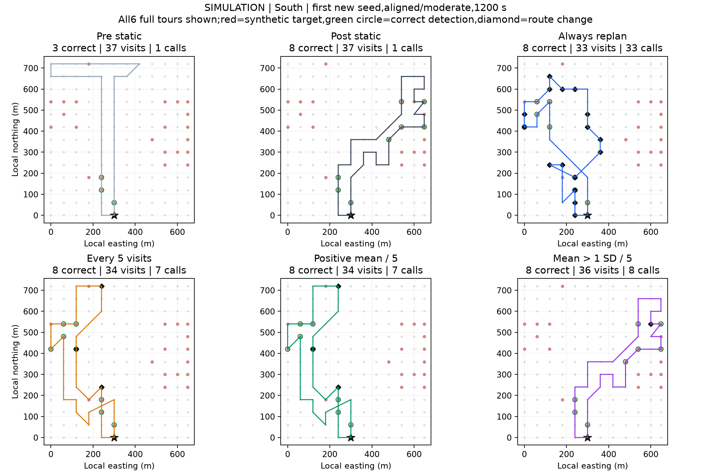

# 付费重规划触发：新合成实例的完整路线检验

2026-11-02。当前已完成六种完整路线策略的对照。主问题是何时采用新的剩余巡查路线；感知误差保持固定，没有新感知推理、训练或GPU费用。

## 本轮结论

方法取舍、负例解释及给老师的简短说明见[结果复盘与下一步](结果复盘与下一步.md)。首次到达、覆盖及零目标分母补充见[arrival_coverage_supplement.json](arrival_coverage_supplement.json)。

固定的一标准差规则未带来平均正确发现量提升，不能据此升级为主方法。 20分钟主预算，一标准差规则相对正期望规则的18个条件均值为0正、0平、18负；360条配对路线胜/平/负为87/110/163。每次改路的局部不确定性与完整路线最终发现量并非同一个量，保守筛选不能自动保证更好的完整巡查收益。

| 比较 | 条件均值正 / 平 / 负 | 路线胜 / 平 / 负 | 平均正确发现增量格 |
|---|---|---|---:|
| 每次重规划 − 灾后静态 | 13 / 0 / 5 | 204 / 67 / 89 | +1.619 |
| 每5次直接改路 − 灾后静态 | 17 / 0 / 1 | 194 / 89 / 77 | +1.419 |
| 正期望触发 − 灾后静态 | 17 / 1 / 0 | 193 / 98 / 69 | +1.386 |
| 一标准差触发 − 灾后静态 | 9 / 3 / 6 | 76 / 242 / 42 | +0.578 |
| 一标准差触发 − 正期望触发 | 0 / 0 / 18 | 87 / 110 / 163 | -0.808 |

所有失败条件保留，不据结果调整“一标准差”或间隔5次。预设的全面支配关口通过：**False**。这个关口同时检查发现量、总耗时、规划调用和受限首次发现时间；未通过时只报告权衡，不宣布通用最优。

## 实验范围与六种策略

冻结代码、规则、种子和评价后，才生成120个合成目标场，完成6,480条完整闭合路线。20个新种子为2026110200—2026110219，与旧10个种子无交集；两个PS几何区域、三种先验条件、三档固定误差、600/1200/1800秒全部保留。1200秒是主要预算。每条件20条配对路线，不按结果挑样。

1. 灾前静态：均匀热点先验0.2，只规划一次。
2. 灾后静态：固定变化线索先验，只规划一次。
3. 每次重规划：每次付费观察后，若仍可支付规划、一次观察及返程，就付费重规划并采用新后缀。
4. 每5次直接改路：每5次观察后付费重规划并采用。
5. 正期望触发：相同间隔，付费计算后，只有预计正确发现数增加才接受。
6. 一标准差触发：相同间隔，预计增量超过差值的一个预测标准差才接受。

三种每5次策略只改变是否接受候选，检查时机一致。它们各自走不同路线，最终检查次数可能不同。筛选候选不等于省掉候选计算；拒绝也支付1秒，因此不能宣称一标准差规则相对正期望规则天然节约计算。

## 成本、信息与不确定性

共同使用未改动的插入+2-opt求解器，不设30次观察上限。每次求解生成当前可承诺的剩余路线，未来规划调用在实际发生时另扣。速度5米/秒、观察20秒、每次候选计算1秒，移动、初始规划、被拒绝的候选、采用的候选和返程全部计费。没有重复收取转场距离。规划1秒为模拟假设，实测CPU时间另外报告。

拒绝候选后仍须承担已发生费用：旧后缀如果因此超预算，从末尾删点，直到可返程。该删点在账本中保留。若连付规划费后再观察一次并返程都不可能，则跳过候选计算，沿仍可行的旧后缀执行；后缀耗尽就返程，不额外增加计划外检查。

预期增量以“付费前旧后缀”与“付费后新后缀”比较；共同格子的未来发现数抵消。每个未访问格的正确发现概率是灵敏度×(0.02+0.58×当时热点后验)。方差保留同一热点块内的共享潜变量相关性，其他块条件独立。误报通过已付观测改变热点后验，未访问观测和合成真值不进入规划器。

**一个标准差是固定启发式，不是单次收益保证、95%置信界或经过验证的风险约束。** 先验反转/无信息时，模型的预测均值和方差也可能失配；未据本批输出拟合阈值。

V4所有在线策略均采用上述共同的承诺后缀规则，与V2每次在线求解时预留后续每步规划费的约定不同。因此在线效果只在本轮公平比较，不能与V2绝对分数混合排名；灾前/灾后静态求解规则保持，2,160条本轮静态轨迹已核验。

## 主预算完整结果

| 区域 | 先验 | 误差 | 一标准差−正期望 | 一标准差−灾后静态 | 正期望−灾后静态 |
|---|---|---|---:|---:|---:|
| 口岸 | Aligned | perfect | -1.30 | +1.75 | +3.05 |
| 口岸 | Aligned | moderate | -1.20 | +0.10 | +1.30 |
| 口岸 | Aligned | poor | -0.35 | -0.25 | +0.10 |
| 口岸 | Reversed | perfect | -0.35 | +1.85 | +2.20 |
| 口岸 | Reversed | moderate | -1.30 | +0.20 | +1.50 |
| 口岸 | Reversed | poor | -0.05 | -0.05 | +0.00 |
| 口岸 | Uninformative | perfect | -0.60 | +2.30 | +2.90 |
| 口岸 | Uninformative | moderate | -1.50 | +0.10 | +1.60 |
| 口岸 | Uninformative | poor | -0.20 | -0.15 | +0.05 |
| 南侧建筑区 | Aligned | perfect | -0.55 | +1.50 | +2.05 |
| 南侧建筑区 | Aligned | moderate | -0.25 | +0.00 | +0.25 |
| 南侧建筑区 | Aligned | poor | -0.70 | -0.15 | +0.55 |
| 南侧建筑区 | Reversed | perfect | -1.55 | +1.85 | +3.40 |
| 南侧建筑区 | Reversed | moderate | -0.85 | +0.00 | +0.85 |
| 南侧建筑区 | Reversed | poor | -0.75 | -0.15 | +0.60 |
| 南侧建筑区 | Uninformative | perfect | -1.70 | +1.65 | +3.35 |
| 南侧建筑区 | Uninformative | moderate | -0.70 | +0.00 | +0.70 |
| 南侧建筑区 | Uninformative | poor | -0.65 | -0.15 | +0.50 |

以下每行等权汇总两个区域及三种先验，共120次共享合成实例；仅供描述，不能当作120次独立灾害。

| 误差 | 策略 | 正确发现格 | 观察数 | 付费规划次数 | 采用候选次数 | 受限首次发现秒 | 无正确发现率 | 往返米 |
|---|---|---:|---:|---:|---:|---:|---:|---:|
| perfect | 灾前静态 | 5.750 | 37.00 | 1.00 | 0.00 | 365.8 | 10.0% | 2245 |
| moderate | 灾前静态 | 4.583 | 37.00 | 1.00 | 0.00 | 414.3 | 12.5% | 2245 |
| poor | 灾前静态 | 3.458 | 37.00 | 1.00 | 0.00 | 477.2 | 17.5% | 2245 |
| perfect | 灾后静态 | 6.417 | 37.00 | 1.00 | 0.00 | 438.4 | 13.3% | 2285 |
| moderate | 灾后静态 | 5.317 | 37.00 | 1.00 | 0.00 | 469.6 | 15.8% | 2285 |
| poor | 灾后静态 | 4.258 | 37.00 | 1.00 | 0.00 | 496.0 | 21.7% | 2285 |
| perfect | 每次重规划 | 9.325 | 30.15 | 30.09 | 29.09 | 349.1 | 5.0% | 2797 |
| moderate | 每次重规划 | 7.458 | 32.04 | 32.00 | 31.00 | 367.1 | 8.3% | 2590 |
| poor | 每次重规划 | 4.067 | 33.65 | 33.62 | 32.62 | 590.7 | 25.0% | 2425 |
| perfect | 每5次直接改路 | 9.117 | 33.12 | 6.97 | 5.97 | 337.9 | 6.7% | 2608 |
| moderate | 每5次直接改路 | 6.550 | 33.69 | 7.04 | 6.04 | 408.2 | 13.3% | 2556 |
| poor | 每5次直接改路 | 4.583 | 35.20 | 7.41 | 6.41 | 492.3 | 17.5% | 2393 |
| perfect | 正期望触发 | 9.242 | 33.27 | 7.03 | 4.27 | 337.9 | 6.7% | 2593 |
| moderate | 正期望触发 | 6.350 | 33.93 | 7.09 | 3.77 | 419.4 | 14.2% | 2526 |
| poor | 正期望触发 | 4.558 | 35.67 | 7.57 | 2.60 | 470.5 | 17.5% | 2359 |
| perfect | 一标准差触发 | 8.233 | 35.08 | 7.53 | 0.82 | 393.0 | 3.3% | 2398 |
| moderate | 一标准差触发 | 5.383 | 35.92 | 7.92 | 0.08 | 471.7 | 15.8% | 2297 |
| poor | 一标准差触发 | 4.108 | 36.00 | 8.00 | 0.00 | 497.0 | 21.7% | 2285 |

首次到达目标与首次正确发现均保留原值；失败为null，另报无发现率。上表受限时间在无发现时填预算；无目标时召回为null。原始逐步路径和假阳性结果完整保留。

## 固定路线示例

两区都展示事前固定的第一个新种子、先验正确、中等误差、20分钟全部六种策略。红点是模拟目标，绿圈是正确发现，黑色菱形标记观察后改变剩余路线的位置，星号为同一起终点。示例不替换成有利案例。

## 核验与适用范围

53项测试通过，其中新增14项。独立重建全部120个目标场、227,037次观察、60,611次付费规划和54,131次候选决定；9,775次拒绝仍按1秒记账。观察、费用、后验、候选、接受标准、返回和评分全部重放，预算违规0，免费候选求解0；旧V1/V2/V3和老师汇报的46个归档文件保持不变。

本机CPU运行循环约129.79秒，规划接口累计实测44.40秒。无GPU、训练、新影像下载或真实PS标签。原PS独立目标空表未填。

这次解决了只在静态行为快照上测试的限制：触发规则已沿自己产生的在线状态执行到返程。但新种子仍来自同一3×3热点模型、相同已知误差率和相同两块PS几何；先验条件共享随机流，预算/噪声/方法共享目标和观察抽样。它不是新的独立灾害、真实损伤验证或物理航线验证。平面直线移动仍缺地形、障碍、相机覆盖和飞行约束。

下一步先把完整路线的发现量、及时性、调用成本和负例作为方法选择依据，不在本批上继续调整阈值追分。保留已验证的简单基线，下一轮另行固定一个实际需要检验的因素，例如误差率未知或真实移动约束；不能把继续添加启发式当成研究贡献已经成立。
